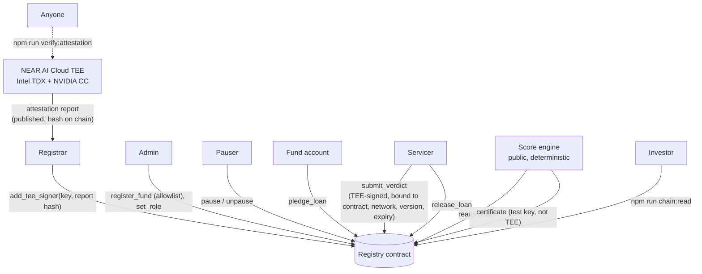
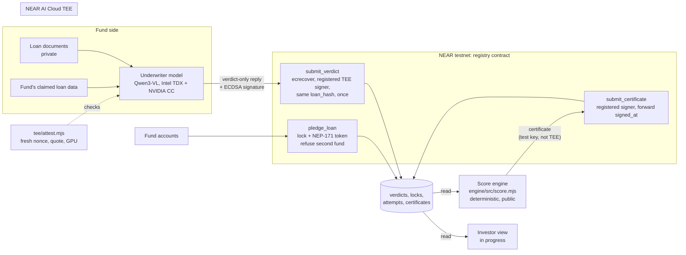

# Architecture

## Trust flow

## Data flow

| Part | Where | Tests |
| --- | --- | --- |
| Score engine (TrueVal, TrueRange, TrueNav score, R1 to R25) | `engine/`, rules in `spec/nav/NAV_SPEC.md` | `npm test` |
| Certificates (engine result to signed message) | `certify/certificate.mjs` | `npm test`, `npm run e2e` |
| Registry contract (Rust, near-sdk 5.30.1) | `contract/` | `cd contract && cargo test` |
| TEE attestation, documents, underwriter | `tee/` | `npm run tee:demo`, `npm run tee:attest` |
| Live flows | `certify/testnet.mjs`, `certify/sandbox.mjs` | `npm run e2e:testnet`, `npm run e2e:sandbox` |

Data flow for one fund: the fund pledges each loan (one token per loan); the TEE checks each loan's document against the fund's claim and its signed verdict is stored; the engine reads verdicts and pledge times from the chain (the certificate history it uses in the demo still comes from `spec/nav/fixtures.json`; reading it from `get_certificate_history` is next), computes the score, and a certificate with the result is stored. The investor reads everything from the chain.
