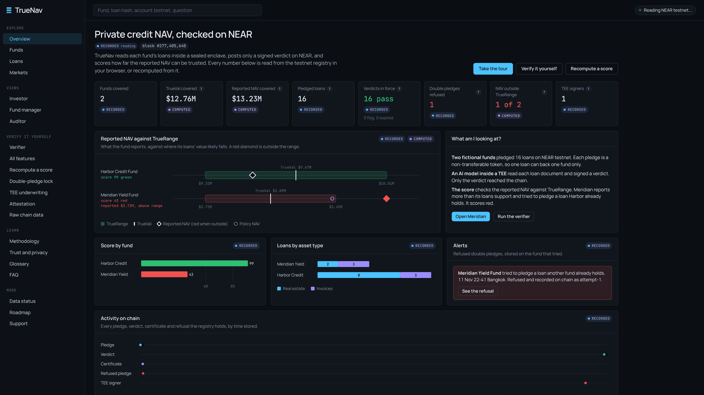
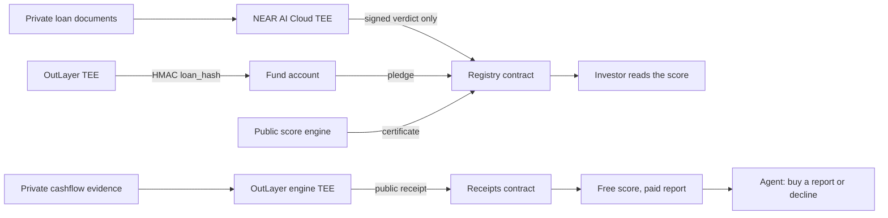
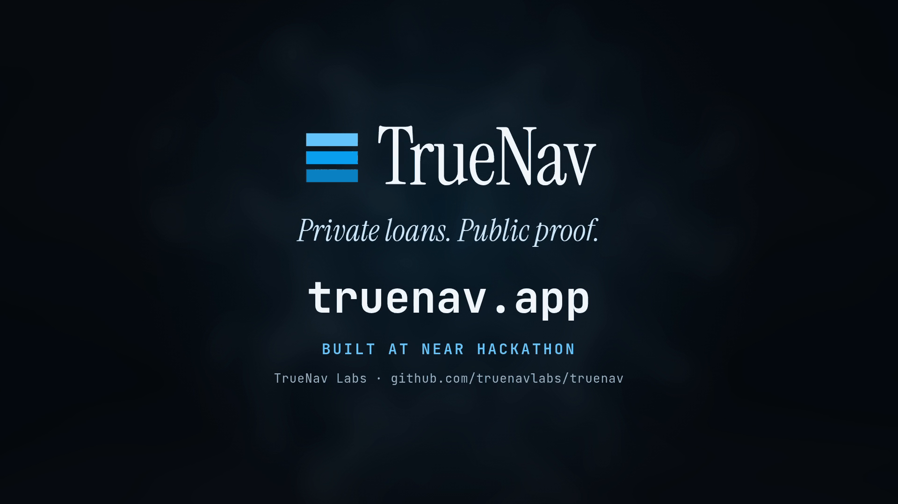
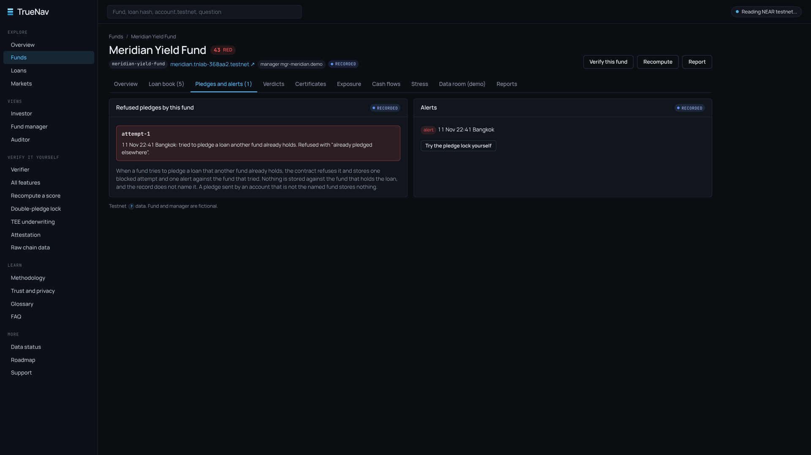
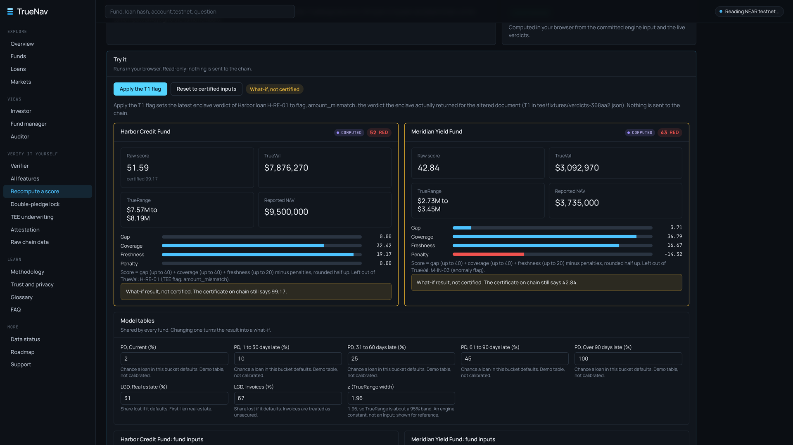
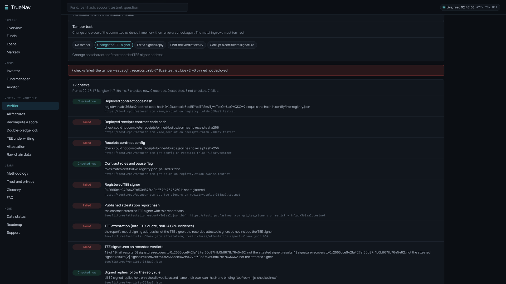
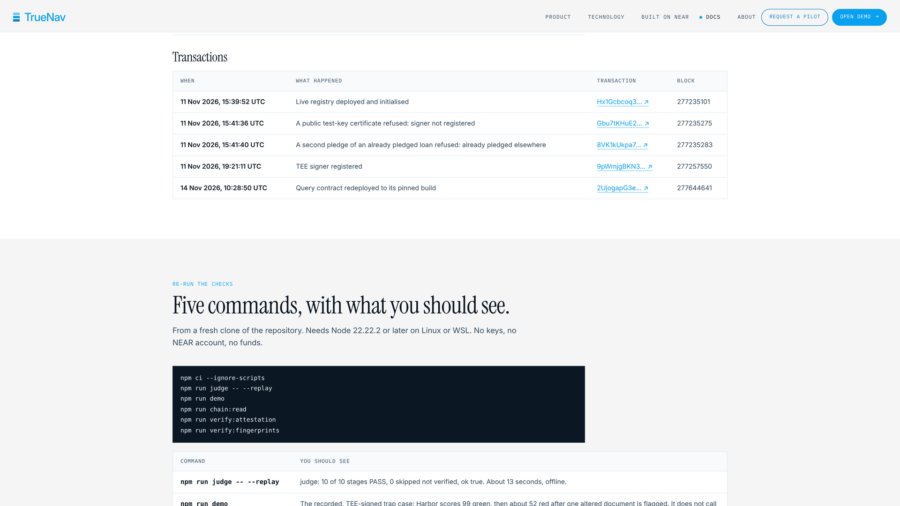

# TrueNav

**What it is.** TrueNav is a credit scorecard for tokenized private-credit funds, built on NEAR. A model in a TEE checks each private loan document against the fund's claim, and TrueNav publishes three numbers per fund: TrueVal, TrueRange and a TrueNav score from 0 to 100.

**Problem.** An investor in a tokenized private-credit fund sees the NAV the fund reports but cannot see the loans behind it. The investor cannot check that the loans are real, that they are worth what the fund says, or that the same loan is not also pledged to another fund.

**Who it is for.** Allocators and fund administrators doing due diligence on tokenized private-credit funds. Prior art is compared [below](#prior-art).

**The one number.** A TEE flag on one altered loan document moves Harbor Credit Fund from 99.17 green to 51.59 red. Reproduce it with `npm run demo`.

TrueNav informs only. It does not move or block any transfer. Testnet and fictional data only.

**Tracks.** Privacy & Private AI (`privacy`, primary) and Open Innovation (`open`). See [Tracks](#tracks).




## Judges start here

Needs Node 22.22.2 or later and Linux or WSL (the API spend store uses util-linux `flock`, so macOS and native Windows can fail some tests). No keys, no NEAR account, no funds, no Docker.

```bash
npm ci --ignore-scripts
npm run judge -- --replay
npm run demo
npm test
```

| Command | You should see | Time |
| --- | --- | --- |
| `npm ci --ignore-scripts` | exit 0. The closing `npm audit` line covers development tools only (the `ganache` local EVM used by mirror tests). For shipped code, `npm audit --omit=dev --audit-level=high` exits 0 with `2 low severity vulnerabilities`. | seconds |
| `npm run judge -- --replay` | `judge: 10 of 10 stages PASS, 0 skipped not verified, ok true` | about 13 s |
| `npm run demo` | the recorded TEE-signed trap case: Harbor `99.17 green`, then `51.59 red`. It does not call the TEE. | 1 s |
| `npm test` | exit 0, `fail 0`, ending `All worked example numbers match.` More than 800 tests; 5 or 6 skip without Rust 1.99.0, Python `jsonschema` or `web/node_modules`. | about 2 min |

Last run on 14 Nov 2026 (Asia/Bangkok), Linux x64, Node v24.22.1. Every step, with full expected output: [docs/TRY_IT.md](docs/TRY_IT.md).

### Open the app

```bash
cd web
npm ci --ignore-scripts
npm test
npm run build
npm run dev
```

`npm run dev` serves the app at `http://127.0.0.1:5173/`. `npm run build` ends with `visual-check: 11 of 11 pages clean`.

1. `/`: the landing page.
2. `/overview`: the dashboard for the demo funds.
3. `/funds/harbor-credit-fund`: Harbor Credit Fund, 99 green (raw 99.17).
4. `/funds/meridian-yield-fund`: Meridian Yield Fund, 43 red (raw 42.84).
5. `/verify`: live testnet accounts compared with the pins in this repository. The query contract matches its pin. The receipts contract is live on v2 and has no stored receipt yet; v3 is pinned, not deployed. Both are shown as expected states, not failures.

### Verify on chain

No keys. Public testnet reads only:

```bash
npm run chain:read
npm run verify:attestation
npm run verify:fingerprints
```

- `chain:read` recomputes both funds from chain data: Harbor `TrueNav score 99 green (raw 99.17)` and Meridian `TrueNav score 43 red (raw 42.84)`, each followed by `-> matches the recomputed score`. Live registry: [`registry.tnlab-368aa2.testnet`](https://testnet.nearblocks.io/address/registry.tnlab-368aa2.testnet), code hash `9Ki2kuenoxie3doBRYbdTPSmzTjwsTosQmUaGwQKCw7o`.
- `verify:attestation` checks the published NEAR AI Cloud attestation report and ends with `Attestation checks passed: the report hash is on chain, the TDX quote and TCB status verify, debug is off, ...`. It says what it does not prove: MRTD and RTMR0 to RTMR2 are not compared with published values.
- `verify:fingerprints` checks the recorded demo loan fingerprints against Intel collateral.

All three were re-run on 14 Nov 2026 and exit 0. Pins and account table: [docs/DEPLOYMENT_EVIDENCE.md](docs/DEPLOYMENT_EVIDENCE.md).

## What is real vs simulated

Checked against this repository and [`docs/DEPLOYMENT_EVIDENCE.md`](docs/DEPLOYMENT_EVIDENCE.md) on 14 Nov 2026.

| Component | Status | What that means |
| --- | --- | --- |
| Live registry `registry.tnlab-368aa2.testnet` | Real, on NEAR testnet | Live `code_hash` matches `certify/live-registry.json`. Host build, not a pinned-image reproducible build. 16 honest TEE verdicts are on chain. |
| Earlier registry `registry.tnlab-718ca9.testnet` | Real, recorded history only | Not the default live read. CI re-reads it in labelled earlier-instance steps. |
| Receipts contract `receipts.tnlab-718ca9.testnet` | Real, live v2 | Live wasm sha256 prefix `f32949b3` does not match the v3 pin `5f294c9a`. Method `cashflow-v2.1.0`, unpaused. |
| Receipts v3 wasm and v3 OutLayer engine | Pinned, not deployed | The v3 receipts pin is in `receipts/pinned-builds.json` and was reproduced in the pinned CI image in [run 43620647260](https://github.com/truenavlabs/truenav/actions/runs/43620647260) on `04116ec` (job `receipts` built `5f294c9a` and matched the pin). The Level 1B upgrade rehearsal ran green in that same run. The live OutLayer project `p0000000000000177` still runs engine `360cd473`. The v3 engine `098f5d86` is not uploaded. |
| Query contract `query.tnlab-718ca9.testnet` | Real, on NEAR testnet, matches pin | Wasm sha256 `dee5f216...`. Code-only redeploy on 14 Nov 2026 at 10:28:50 UTC. |
| OutLayer TEE engine v2 | Real, live on testnet | Project `p0000000000000177`, version `360cd473`. The recorded loan fingerprints were made under the 718ca9 OutLayer project. |
| NEAR AI Cloud underwriter | Real TEE used for live verdicts; offline path is a replay | The 16 on-chain verdicts were signed by the attested key `0x2665cce942fa427ef30d87f4b0bff67fb7645462`. `npm run demo` and `npm run judge -- --replay` replay recorded, TEE-signed replies and do not call the TEE. |
| Mock bank and demo loan documents | Simulated, fictional | Committed so judges can replay them. The mock bank host serves synthetic data only (`X-Synthetic-Data: true`). |
| Public score engine | Real code, runs locally, deterministic | Harbor 99.17 green, Meridian 42.84 red. Anyone can recompute from the same inputs. PD tables are demo, not calibrated. |
| NEAR AI assist in the web app | Real integration, optional | The `/api/assist` function calls NEAR AI Cloud (`Qwen/Qwen3-VL-30B-A3B-Instruct`) when a key is configured. Not required for any step in [docs/TRY_IT.md](docs/TRY_IT.md). Live key behaviour was not verified in this pass. |
| Paid report API and buyer agent | Real code; the judge path uses a local fake chain | Sandbox end-to-end runs in CI with Docker (`npm run e2e:receipts`). Not run locally in this pass. |
| Base Sepolia receipts mirror | Implemented, not deployed | Chain Signatures path in `mirror/` and `receipts/src/mirror.rs`. |
| Receipts printed by `npm run demo` and the offline judge | Synthetic fixtures | Not a live read of `receipts.tnlab-718ca9.testnet`. |
| Receipts v3 source registry | Public TEST fixture only | `engine/v3-core/tests/fixtures/source-registry.TEST.json`. Not a NEAR account, and not the live registry. |

## How it works



1. Each loan is pledged once. The on-chain `loan_hash` is an HMAC computed in an OutLayer TEE. The registry mints a non-transferable NEP-171 token and refuses a second fund's pledge of the same hash.
2. A model in a NEAR AI Cloud TEE (`Qwen/Qwen3-VL-30B-A3B-Instruct`) compares the private document with the fund's claim and signs a verdict-only reply. The document never goes on chain. The contract recovers the EIP-191 signer with `env::ecrecover`, checks it is a registered TEE signer, and stores the verdict.
3. The public score engine in `engine/` computes TrueVal, TrueRange and the TrueNav score from verified loans and chain data. A certificate with those numbers is stored on the registry.
4. A receipts contract can request a pinned OutLayer run over private cashflow evidence and store a public checks receipt. An agent may buy a one-use report entitlement. When the head the API reads is failed, `/report` returns 409 `run_failed` before any redeem, so no use is spent, and the agent buys nothing (see RT2-07 for the one open window).
5. An investor reads the score from the chain (`npm run chain:read`). The registry contract creates no `Promise`, so it makes no cross-contract call and sends no NEAR, and its pledge tokens cannot be transferred (`contract/src/lib.rs`). It has no way to move or block a fund's assets.

The three numbers:

- TrueVal: what the fund's loans are worth after expected losses. A model estimate, not fair value.
- TrueRange: where TrueVal likely falls, assuming loans default independently. A demo estimate.
- TrueNav score (0 to 100): how far the fund's reported NAV can be trusted, from the gap to TrueVal, verified coverage and freshness.

PD tables are demo, not calibrated. The 30 day, 50% and 10% thresholds are TrueNav's own policy, not agency figures. Rules: `spec/nav/NAV_SPEC.md`.

The Base Sepolia mirror (`mirror/`, `receipts/src/mirror.rs`) can copy a receipt reference, score, band, method hash and timestamp to Base, signed through Chain Signatures. It is implemented and not deployed. It does not recompute the score or verify private data.

## Tracks

- **Privacy & Private AI (`privacy`).** Loan documents and cashflow evidence are checked inside TEEs (NEAR AI Cloud and OutLayer). Only signed verdicts, aggregates and private fingerprints go on chain. The registry contract recovers the TEE signature with `env::ecrecover` and checks the signer is registered before it stores a verdict. The only on-disk state of the API in `api/` is its spend store (spent nonces and a buyer rate counter, `api/spend-store.mjs`). What is protected, what is not, and who could still see what: [TRUST_MODEL.md](TRUST_MODEL.md).
- **Open Innovation (`open`).** A public scorecard for private-credit NAVs that anyone can recompute by hand, with a no-funds path to try it. Why NEAR: [WHY_NEAR.md](WHY_NEAR.md).

## Limits

TrueNav is a testnet prototype. What is missing before a real user could rely on it:

- Fictional data only. PD tables are demo, not calibrated. TrueRange assumes independent defaults. TrueNav informs only.
- The underwriter is an LLM. A TEE proves which code ran, not that the model's judgment is right. The eval is 126 synthetic documents written by the team that wrote the prompt; a perfect score means no failure was found there, not that it cannot fail.
- TEE signer registration and certificate signing are phase-1 trust: registrar and operator keys, not on-chain quote verification. The attestation checks do not pin MRTD or RTMR0 to RTMR2, so they do not prove which image runs.
- One full-access key on the live registry can replace its code. No multisig or DAO.
- No stored receipt on the live receipts contract; v3 and the v3 OutLayer engine are pinned and not deployed. The Base mirror is not deployed.
- The live registry wasm is a host build, not a reproducible one.

Full list with status, roles and keys: [docs/KNOWN_LIMITS.md](docs/KNOWN_LIMITS.md). Claims and how to verify each: [docs/CLAIMS.md](docs/CLAIMS.md). Mainnet: [docs/NETWORK.md](docs/NETWORK.md).

## Prior art

Checked on 12 Nov 2026 from each project's public docs or README. The descriptions are our reading of those pages, not a review of the systems.

| Project | What it does | How TrueNav differs |
| --- | --- | --- |
| Centrifuge ([NAV and oracles](https://docs.centrifuge.io/developer/protocol/guides/publish-nav-and-oracles/)) | The issuer computes a pool's NAV, typically off chain, and publishes a share price on chain with `hub.updateSharePrice`. Holdings that live on chain can be valued by valuation contracts. | TrueNav does not publish the NAV. It scores how far a reported NAV can be trusted, from private loan documents checked in a TEE and a cross-fund pledge registry. |
| Maple ([Pool accounting](https://docs.maple.finance/technical-resources/pools/pool-accounting)) | Pool value is cash plus the outstanding principal and accrued interest of its on-chain loans. The Pool Delegate or Governor records impairments. | Maple values loans that are its own contracts. TrueNav targets loans whose documents stay off chain and private. |
| Midas ([Oracle architecture](https://docs.midas.app/transparency/oracle-architecture)) | The strategy manager provides the NAV. Midas reviews it with at least 2 co-signers and pushes it to an on-chain feed with deviation and freshness checks. | Those checks are on the published number. TrueNav checks the documents behind the number without publishing them. |
| Fund-administrator NAV and proof-of-reserve feeds (a general pattern, not one project) | Carry a NAV or reserve figure from an administrator or custodian onto a chain, sometimes with TEE or zkTLS proof that the figure came unaltered from that source. | They show where a number came from. TrueNav asks whether the loans support it, and whether the same loan is pledged to two funds. |
| NEAR AI Cloud verifier ([nearai/nearai-cloud-verifier](https://github.com/nearai/nearai-cloud-verifier)) | Official off-chain tools that verify NEAR AI Cloud attestation reports and response signatures. | TrueNav runs the same kind of checks off chain (`npm run verify:attestation`), and its registry contract also recovers the response signer on chain with `env::ecrecover` before it stores a verdict. |
| RedPill verifier ([redpill-ai/redpill-verifier](https://github.com/redpill-ai/redpill-verifier)) | A library that verifies TEE inference proofs, including NEAR AI ones, and can store a proof in a contract on Sepolia. | General inference verification on an EVM test network. TrueNav binds each signed verdict to one NEAR contract, network, loan and expiry. |
| Bargo ([claraexmachina/bargo](https://github.com/claraexmachina/bargo)) | Negotiation that uses NEAR AI Cloud inference. Its settlement contract on Status Network stores an attestation hash, and the attestation is verified off chain. | TrueNav's NEAR contract checks the TEE signature itself before it acts. |
| TrustlessInference ([lfglabs-dev/TrustlessInference](https://github.com/lfglabs-dev/TrustlessInference)) | An EVM gateway contract that recovers a TEE-signed inference proof with `ecrecover` and stores it. Its README shows a mock TEE platform id. | The same on-chain signature idea. TrueNav applies it to NEAR AI Cloud verdicts on private loan documents, next to a pledge registry. |

In this search we found no NEAR project that checks private loan documents in a TEE and also refuses a second fund's pledge of the same loan. That is a search result, not proof that none exists.

## How NEAR is used

| Primitive | Where | Why it is needed | Docs |
| --- | --- | --- | --- |
| NEAR AI Cloud TEE, attestation, ECDSA signatures | `tee/`, checked by the registry in `contract/` | Private document checks become public, verifiable verdicts. The contract uses `env::ecrecover` | [Verification](https://docs.near.ai/cloud/verification) |
| OutLayer TEE (Intel TDX, attestation per run) | `outlayer/`, `receipts/`, `tee/fingerprint.mjs` | Loan fingerprints and cashflow receipts are computed with a key that does not leave the TEE | [OutLayer](https://app.outlayer.ai/docs/getting-started) |
| NEP-171 pledge tokens | `contract/` | One token per pledged loan; a second pledge of the same hash is refused | [NFT standard](https://docs.near.org/primitives/nft/standard) |
| Access keys and 1 yoctoNEAR | `contract/` | Sensitive calls attach 1 yoctoNEAR, so a function-call key cannot make them | [Access keys](https://docs.near.org/protocol/accounts-contracts/access-keys) |
| NEP-330 reproducible builds | `receipts/pinned-builds.json`, CI pinned image `sourcescan/cargo-near:0.22.0-rust-1.99.0` | Only the receipts and query wasm are pinned-image builds, so their hashes can be compared with `receipts/pinned-builds.json` (the live query contract matches its pin). The live registry wasm is a host build (364904 bytes, code hash `9Ki2kuenoxie3doBRYbdTPSmzTjwsTosQmUaGwQKCw7o`, `contract_source_metadata` has `build_info` null) and cannot be rebuilt to the same hash today. A reproducible registry build is future work. | [Reproducible builds](https://docs.near.org/smart-contracts/anatomy/reproducible-builds) |
| Sub-accounts | `certify/testnet.mjs` | A judge's own testnet run stays under one account |  |
| Chain Signatures to Base Sepolia | `mirror/`, `receipts/src/mirror.rs` | An EVM reader can see the same receipt reference. Not deployed | [Chain Signatures](https://docs.near.org/chain-abstraction/chain-signatures/getting-started) |

More detail: [`WHY_NEAR.md`](WHY_NEAR.md) and `ARCHITECTURE.md`.

## Build window

The NEAR HACKATHON development window is 1 Nov 2026 00:00 UTC to 14 Nov 2026 23:59 UTC (Q-001). There is no pre-hackathon baseline. The entire git history falls inside that window.

Reproduce the dated range from this repository:

```bash
git log --reverse --format=%ci | head -1
# 2026-11-05 11:46:26 +0700
# first commit 4874363, 2026-11-05 04:46:26 UTC

git log -1 --format=%ci
# 2026-11-14 18:01:43 +0700
# the commit that was main when this section was written (db601c5), 2026-11-14 11:01:43 UTC
```

These commits are after the 19 Oct 2026 announcement and before development ends. History may be squashed when the repository is made public. The dated range here is the record.

On-chain testnet transactions already listed in this README and in `docs/DEPLOYMENT_EVIDENCE.md`, with block timestamps from the NearBlocks testnet API (`https://api-testnet.nearblocks.io/v1/txns/<hash>`), converted to UTC:

- 2026-11-11 15:39:52 UTC: live registry deploy and init, [Hx1Gcbcoq3F7W5DDUYtgLoEsyKVPeVcn7vZ19Hy4BkXE](https://explorer.testnet.near.org/transactions/Hx1Gcbcoq3F7W5DDUYtgLoEsyKVPeVcn7vZ19Hy4BkXE), block 277235101.
- 2026-11-11 15:41:36 UTC: a public test-key certificate was refused (`signer not registered`), [Gbu7tKHuE2WVfSMduS1MNyuMRf6TQSQyou2gr9ozXrnQ](https://explorer.testnet.near.org/transactions/Gbu7tKHuE2WVfSMduS1MNyuMRf6TQSQyou2gr9ozXrnQ), block 277235275.
- 2026-11-11 15:41:40 UTC: a second pledge of an already pledged loan was refused (`already pledged elsewhere`), [8VK1kUkpa7Gs8dStznffdDAM9uHVbfodHWBUvbfQMwrs](https://explorer.testnet.near.org/transactions/8VK1kUkpa7Gs8dStznffdDAM9uHVbfodHWBUvbfQMwrs), block 277235283.
- 2026-11-11 19:21:11 UTC: TEE signer registered, [9pWmjgBKN37VzMVBUo8vw3ygJ3PsPtnhp5D7wczaktvE](https://explorer.testnet.near.org/transactions/9pWmjgBKN37VzMVBUo8vw3ygJ3PsPtnhp5D7wczaktvE), block 277257550.
- 2026-11-14 10:28:50 UTC: query contract code-only redeploy to the pinned wasm, [2UjogapG3eALhSTjq6GXiaymrqGBvBVX8ZrFbvGjhnq8](https://testnet.nearblocks.io/txns/2UjogapG3eALhSTjq6GXiaymrqGBvBVX8ZrFbvGjhnq8), block 277644641.

## Demo

- Demo video: [88-second walkthrough](docs/media/truenav-demo.mp4)
- X post: TBD
- Live app: https://truenav.app (launching after final pass; not live yet)

[](docs/media/truenav-demo.mp4)



*The registry refuses a second pledge of a loan another fund already holds.*



*Harbor moves from 99 green to 52 red when one recorded loan document is flagged.*



*Changing the TEE signer turns the checks red. The tamper is caught.*



*Public transactions on the live registry, including the refused pledge.*

## Hackathon disclosures

- **Window (Q-001, Q-003).** There is no pre-hackathon baseline. The first commit is `4874363` on 5 Nov 2026, after the 19 Oct 2026 announcement. The entire history is in the judging window. There is no `pre-hackathon` tag and no pre-hackathon diff to link. See [Build window](#build-window) for the dated commit range and on-chain timestamps.
- **Other chains (Q-002).** TrueNav is not an existing product brought over from another chain. The Base Sepolia mirror is a Chain Signatures path so an EVM reader can see a receipt reference. It lives in `mirror/` and `receipts/src/mirror.rs`. It is not deployed.
- **Libraries and tools (Q-005).** Pinned in `package-lock.json` and the Cargo lockfiles: near-sdk 5.30.1 and near-contract-standards (Rust), near-api-js 7.3.1, near-sandbox 0.3.4, `@noble/curves` 2.4.0, `@noble/hashes` 2.4.0, `@phala/dcap-qvl` 0.7.0, ganache 7.9.2, solc 0.8.30, viem 2.38.5, Python `jsonschema` 4.23.0, cargo-near and the `sourcescan/cargo-near:0.22.0-rust-1.99.0` build image. Runtime services: NEAR AI Cloud (`Qwen/Qwen3-VL-30B-A3B-Instruct`), OutLayer, NVIDIA NRAS for GPU attestation.
- **AI tools (Q-005).** Code, tests and docs were written with cloud coding agents and AI assistants (including Claude Code, Codex and Cursor cloud agents) under the team's direction and review. Outside models (GPT-5.5, Gemini 3.1 Pro, Claude Opus 5.5 via OpenRouter) gave second opinions on scoring rules and contract audit findings. The findings and the status we gave each are in `AUDIT_FINDINGS.md`.
- **Demo (Q-012).** The demo poster, stills and a compact walkthrough are in [Demo](#demo). The X post is not published yet. Every step in [docs/TRY_IT.md](docs/TRY_IT.md) runs locally with no keys or funds.

## Other entry (Q-015 disclosure)

The same submitter also entered [TendAI Custody](https://tendaicustody.app) in NEAR HACKATHON. The two projects are independent, with separate code, contracts and deployments, and neither depends on the other.

Built at NEAR HACKATHON 2026 by TrueNav Labs. Repository: [https://github.com/truenavlabs/truenav](https://github.com/truenavlabs/truenav).

## License

MIT License. See `LICENSE`. Copyright 2026 TrueNav Labs.

## Docs

- [`docs/TRY_IT.md`](docs/TRY_IT.md): every run step with expected output, and the optional live testnet reads.
- [`docs/CLAIMS.md`](docs/CLAIMS.md): each claim and the command or test that checks it.
- [`docs/KNOWN_LIMITS.md`](docs/KNOWN_LIMITS.md): roles and keys, security notes and the open items.
- [`docs/NETWORK.md`](docs/NETWORK.md): testnet only, and what mainnet would change.
- [`docs/DEPLOYMENT_EVIDENCE.md`](docs/DEPLOYMENT_EVIDENCE.md): live testnet accounts, pins, and whether the live code matches.
- [`ARCHITECTURE.md`](ARCHITECTURE.md): diagrams and where each part lives.
- [`TRUST_MODEL.md`](TRUST_MODEL.md): what is proven on chain, what is trusted, privacy, what is not claimed.
- [`THREAT_MODEL.md`](THREAT_MODEL.md): attacks, mitigations and the test that shows each.
- [`SECURITY.md`](SECURITY.md) and [`AUDIT_FINDINGS.md`](AUDIT_FINDINGS.md): reporting, practices and findings.
- [`WHY_NEAR.md`](WHY_NEAR.md): what NEAR enables here.
- `tee/eval/REPORT.md`: TEE underwriter eval and its limits.
- `spec/nav/NAV_SPEC.md`: score rules.
