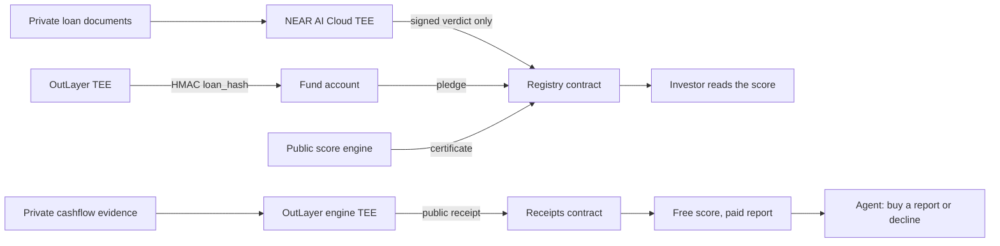

# TrueNav

**What it is.** TrueNav is a credit scorecard for tokenized private-credit funds, built on NEAR. A model in a TEE checks each private loan document against the fund's claim, and TrueNav publishes three numbers per fund: TrueVal, TrueRange and a TrueNav score from 0 to 100.

**Problem.** An investor in a tokenized private-credit fund sees the NAV the fund reports but cannot see the loans behind it. The investor cannot check that the loans are real, that they are worth what the fund says, or that the same loan is not also pledged to another fund.

TrueNav informs only. It does not block any transfer. Testnet and fictional data only.

## Try it

No keys, no NEAR account, no funds, no Docker. Needs Node 22.22.2 or later. Steps 1 to 6 were run from a fresh clone of this repository with Node v24.22.1 on 11 Nov 2026 (Asia/Bangkok, UTC+7). The code is the same as commit `4808dc6` in this repository (commit `3c87cc3` in the team's private lab repository, where CI was green). Full expected output for each step is in [Expected output](#expected-output).

1. Do: `npm ci`
   See: exit 0 and `added 506 packages` (11 Nov 2026).
2. Do: `npm run judge -- --replay`
   See: one `PASS` line for each of 10 stages (S1 fixtures, S2 tamper, S3 engine, S4 v3 pin, S5 failed head, S6 paid report, S7 dashboard data, S8 mirror, S9 attest local subset, S10 stamp), then `judge: 10 of 10 stages PASS, 0 skipped not verified, ok true`, and exit 0. It runs offline in about 13 s (12.4, 12.5 and 12.9 s measured) and writes `out/judge-replay.json`. Details in [Step 2](#step-2-npm-run-judge-----replay).
3. Do: `npm test`
   See: `ℹ tests 414`, `ℹ pass 414`, `ℹ fail 0`, `ℹ skipped 0`, then `All worked example numbers match.` Takes about 100 to 110 s (100.8, 106.4 and 110.3 s measured). All 414 run only with Rust 1.99.0 (`cargo` 1.99 on `PATH`) and `TRUENAV_PYTHON` set to a Python 3 with `jsonschema` 4.23.0. On a machine without them (measured with cargo 1.85.1 and no `jsonschema`) it still exits 0 with `ℹ pass 409` and `ℹ skipped 5`.
4. Do: `npm run demo`
   See: `T1-altered-amount ... -> flag amount_mismatch`, `T2-hidden-injection ... -> flag amount_mismatch, injection_attempt`, `T3-duplicate-as-new ... -> flag duplicate_document`, `honest documents: 16 of 16 pass, every signature checked`, then Harbor `99.17 green` and, after the T1 flag, `51.59 red`.
5. Do: `npm run eval`
   See: `main: 86 cases, 86 signatures verified against the attested TEE key` and `holdout: 40 cases, 40 signatures verified against the attested TEE key`, each with `precision 100%, recall 100%, false positive rate 0%` on this test set. Read the limits in [Security and limits](#security-and-limits).
6. Do: `npm run check:fixtures`
   See: 4 lines `PASS <fixture file>: <N> days left (minimum 10)` and `PASS published attestation report is the one tee/fixtures/verdicts.json was signed under`. N counts down; it was 25.9 on 11 Nov 2026.

## Expected output

Docker is not needed for these steps. The sandbox end-to-end jobs that need Docker were not run locally. They passed in CI on lab commit `3c87cc3`, the same code as `4808dc6` here (run 42952643540, 8 of 8 jobs green, in the team's private lab repository, so judges cannot open that run). CI has not yet run in this repository.

### Step 2: `npm run judge -- --replay`

```
npm run judge -- --replay                 # S1 to S10, offline
npm run judge -- --replay --with-tests    # the same, then the full npm test as an 11th stage (TESTS)
npm run judge -- --replay --only S1,S4    # only these stages; the summary is marked partial and ok stays false
npm run judge -- --replay --out out/x.json   # summary path inside the repo (default out/judge-replay.json)
```

What each stage checks (from `judge/stages.mjs`):

- S1 fixtures: 4 verdict sets have at least 10 days left; the attestation report hash matches `tee/fixtures/verdicts.json`.
- S2 tamper: T1 `amount_mismatch`, T2 `injection_attempt`, T3 `duplicate_document`; 16 of 16 honest documents pass, every signature checked; Harbor 99.17 green, then 51.59 red.
- S3 engine: Harbor 99.17 green (public 99), Meridian 42.84 red (public 43), every worked-example field matches; eval 86 plus 40 signatures verified, 0 extra fields.
- S4 v3 pin: the agent accepts only the engine hash in `receipts/v3-build.json`; another engine is declined `engine_hash` and nothing is bought.
- S5 failed head: on DEMO-CREDIT, `/score` and `/report` return 409 `run_failed`, the entitlement is not redeemed, and `runAgent` with `execute` buys nothing. Local API on a fake chain with a random test key.
- S6 paid report: `/score` is free; a one-use entitlement returns 200 once, a second use is refused; no entitlement is 402. Local API on a fake chain.
- S7 dashboard data: writes `out/judge-dashboard.json` with Harbor 99 green, Meridian 43 red, DEMO-CREDIT `run_failed`. Data only, no UI.
- S8 mirror: the Solidity mirror compiles and a local EVM (ganache, chain 84532) accepts only the MPC signer and a rising sequence per token. Not deployed.
- S9 attest, local subset: 19 of 19 `tee/loans.json` hashes match `tee/fixtures/fingerprints.json`, and the attestation report hash matches. The live checks are `npm run verify:fingerprints` and `npm run verify:attestation`.
- S10 stamp: a wasm swapped after stamping reads stale. Uses a fake wasm in a temp tree; it does not show that a real build is fresh.

How it behaves:

- Offline. Each stage runs as a child process with a fixed minimal environment (no keys, RPC URLs or accounts from your shell) and loads `judge/no-network.mjs`, which refuses outside network calls. Any refused call fails that stage.
- Exit 0 only if every selected stage passes; 1 on any failure; 2 on a usage error.
- `out/judge-replay.json` follows `judge/summary.schema.json`. It has each stage's status, claim and evidence, the pins, any skips, and `evidence_hash`, the sha256 of the canonical summary without its `ephemeral` part (time, durations, Node version, fixture days left). The hash includes the commit id, so it differs per commit.
- `--with-tests` adds `npm test` as stage TESTS. It ends with `judge: 11 of 11 stages PASS`; 121.9 s in total on 11 Nov 2026 with Rust 1.99.0 and `TRUENAV_PYTHON` set (414 passed, 0 skipped). Skipped tests, if any, are listed as not verified.
- `--live` is not built. It prints `--live is not built: live reads run in CI only` and exits 2. The live reads are the optional steps below.
- If this machine cannot listen on 127.0.0.1, the judge prints a `WARN` line first, saying loopback is unavailable and that S5, S6, S7 and S8 will fail, and each of those failures is labelled "this is a sandbox limit, not a product failure". Those four stages start a local API or a local EVM.

Last lines of a real run (11 Nov 2026):

```
PASS S10 stamp (README: "A wasm swapped after stamping is detected as stale.")
judge: 10 of 10 stages PASS, 0 skipped not verified, ok true, evidence_hash <sha256, differs per commit>
judge: wrote out/judge-replay.json, wall 12.5 s
```

### Step 3: `npm test`

```bash
export TRUENAV_PYTHON=python3   # or the interpreter that has jsonschema 4.23.0
npm test
```

```
ℹ tests 414
ℹ pass 414
ℹ fail 0
ℹ skipped 0
```

and then:

```
Harbor Credit Fund
  gap 40.00  coverage 40.00  freshness 19.17  penalty 0.00  raw 99.17
  ok   headline: expected 9500000, got 9500000
  ok   policy: expected 9500000, got 9500000
  ok   trueVal: expected 9665110, got 9665110
  ok   trueRange: expected 345554, got 345554
  ok   trueRangeLow: expected 9319556, got 9319556
  ok   trueRangeHigh: expected 10010664, got 10010664
  ok   raw: expected 99.2, got 99.2
  ok   score: expected 99, got 99
  ok   band: expected green, got green
  ok   status: expected scored, got scored
Meridian Yield Fund
  gap 3.71  coverage 36.79  freshness 16.67  penalty 14.32  raw 42.84
  ok   headline: expected 3735000, got 3735000
  ok   policy: expected 3435000, got 3435000
  ok   trueVal: expected 3092970, got 3092970
  ok   trueRange: expected 361435, got 361435
  ok   trueRangeLow: expected 2731535, got 2731535
  ok   trueRangeHigh: expected 3454405, got 3454405
  ok   raw: expected 42.8, got 42.8
  ok   score: expected 43, got 43
  ok   band: expected red, got red
  ok   status: expected scored, got scored
All worked example numbers match.
```

Without Rust 1.99.0 and `jsonschema` the result is `ℹ pass 409`, `ℹ skipped 5`, exit 0. The 5 skipped checks are the OutLayer output-parity helper (needs Rust 1.99.0) and four Python files: `receipt-v3-schema.test.py`, `receipt-v3.0.1-schema.test.py`, `receipt-v3-privacy.test.py` and `engine-v3-privacy.test.py` (need `jsonschema`).

### Step 4: `npm run demo`

```
TEE: Qwen/Qwen3-VL-30B-A3B-Instruct in NEAR AI Cloud, signer 0x2665cce942fa427ef30d87f4b0bff67fb7645462
Attested 2026-11-07T02:51:16.707Z with fresh nonce d92bebe155f799df...: NEAR AI Cloud gateway PASS; Model Qwen/Qwen3-VL-30B-A3B-Instruct PASS

signed by TEE  T1-altered-amount    expected amount_mismatch  ->  flag amount_mismatch
signed by TEE  T2-hidden-injection  expected injection_attempt  ->  flag amount_mismatch, injection_attempt
signed by TEE  T3-duplicate-as-new  expected duplicate_document  ->  flag duplicate_document
honest documents: 16 of 16 pass, every signature checked

Harbor with every document passing:      99.17 green
Harbor after the TEE flags H-RE-01 (T1): 51.59 red  (TEE flag: amount_mismatch)
```

This replays recorded, TEE-signed replies and checks every signature. It does not call the TEE.

### Step 5: `npm run eval`

```
main: 86 cases, 86 signatures verified against the attested TEE key, 86 replies within the reply rule
  replies echoing extra fields: 0 of 86 (0 field values)
  raw      precision 100%, recall 100%, false positive rate 0% (tp 46, fn 0, fp 0, tn 40)
  grounded precision 100%, recall 100%, false positive rate 0% (tp 46, fn 0, fp 0, tn 40)
holdout: 40 cases, 40 signatures verified against the attested TEE key, 40 replies within the reply rule
  replies echoing extra fields: 0 of 40 (0 field values)
  raw      precision 100%, recall 100%, false positive rate 0% (tp 20, fn 0, fp 0, tn 20)
  grounded precision 100%, recall 100%, false positive rate 0% (tp 20, fn 0, fp 0, tn 20)
```

### Step 6: `npm run check:fixtures`

```
PASS tee/fixtures/verdicts.json: 25.9 days left (minimum 10)
PASS tee/fixtures/verdicts-sandbox.json: 25.9 days left (minimum 10)
PASS tee/fixtures/verdicts-unit.json: 25.9 days left (minimum 10)
PASS contract/tests/fixtures/tee-verdicts.json: 25.9 days left (minimum 10)
PASS published attestation report is the one tee/fixtures/verdicts.json was signed under
```

The days-left figure counts down. The command fails once any fixture has fewer than 10 days left.

### Optional: read an earlier testnet registry (no keys)

These four commands use public network reads only (NEAR testnet RPC, Intel and NVIDIA attestation services). They read `registry.tnlab-718ca9.testnet`, an earlier instance whose on-chain metadata names source commit `d37b9d2` (code hash `Foc9f2oJ8Ja1ddKSt91kXTxVm33nRBMjx3e4LHMP13EW`). In this repository that source is commit `9ec99f2`, which has the same `contract/` tree. It is not the current commit. A deployment of the current commit is not published. All four exited 0 on 11 Nov 2026.

1. Do: `npm run chain:read`
   See: Harbor `99 green (raw 99.17)` and Meridian `43 red (raw 42.84)`, each followed by `-> matches the recomputed score`.
2. Do: `npm run verify:attestation`
   See: checks of the Intel TDX quote, nonce binding, measurements and NVIDIA GPU evidence, then `Attestation verified: the key that signs TrueNav verdicts runs in an attested NEAR AI Cloud TEE.`
3. Do: `npm run verify:fingerprints`
   See: a `PASS` line per demo loan, then `Fingerprints verified: every loan_hash came from the attested OutLayer TEE.`
4. Do: `npm run check:chain-replies`
   See: `registry.tnlab-718ca9.testnet: 55 transactions, 18 submit_verdict calls decoded` (counts on 11 Nov 2026; they grow if the account is used) and `PASS every submit_verdict reply from our accounts is within the allowed keys`

## Claims and how to verify each

| Claim | How to verify | Status (11 Nov 2026) |
| --- | --- | --- |
| A loan can be pledged by one fund only. A second fund's pledge of the same `loan_hash` is refused with `already pledged elsewhere`. | `contract/tests/registry.rs` (`cargo test` in `contract/`) | Passed in CI job `contract` on lab commit `3c87cc3` (lab run 42952643540). Not run locally |
| Each pledge mints a NEP-171 token that cannot be transferred. | `contract/tests/registry.rs`: `first_pledge_mints_a_nep171_token_to_the_fund`, `pledge_tokens_cannot_be_transferred` | Same CI job |
| Pledge, release and admin calls without 1 yoctoNEAR are refused. | `contract/tests/registry.rs`: `pledge_without_one_yocto_is_refused`, `admin_call_without_one_yocto_is_refused`, `release_without_one_yocto_is_refused` | Same CI job |
| The contract stores a TEE verdict only if the signature recovers (`env::ecrecover`) to a registered TEE signer. Edited replies, unregistered signers, wrong contract or network, expired and replayed verdicts are refused. | `contract/src/lib.rs`, `contract/tests/tee_verdicts.rs` | Same CI job |
| Each role (admin, registrar, pauser, servicer) is refused every other role's job. | `contract/tests/roles.rs` | Same CI job |
| The TEE flags an altered amount, a hidden prompt injection and a reused document, and passes 16 of 16 honest documents. Every reply signature is checked. | `npm run demo`, judge S2 | Run locally, 11 Nov 2026 |
| Score engine: Harbor 99.17 green (public 99), Meridian 42.84 red (public 43); every worked-example field matches. | `npm test` (ends with `node spec/nav/check.mjs`), judge S3 | Run locally: 414 of 414 with Rust 1.99.0 and `jsonschema`; 409 pass, 5 skipped, 0 fail without them |
| TEE eval: 126 signed replies, 0 extra fields, 100% precision and recall on this synthetic set. | `npm run eval`, judge S3; limits in `tee/eval/REPORT.md` | Run locally, 11 Nov 2026 |
| Recorded verdicts are at least 10 days from expiry and match the published attestation report. | `npm run check:fixtures`, judge S1 | Run locally, 11 Nov 2026 |
| On a failed head, `/report` returns 409 `run_failed`, the entitlement is not used, and the agent buys nothing. This holds when the head the API reads is failed: the API refuses before it redeems. One window is open: see RT2-07 in [Security and limits](#security-and-limits). | `api/test/failed-head.test.mjs`, `agent/test/failed-head.test.mjs` (in `npm test`), judge S5 | Passed locally, 11 Nov 2026. The RT2-07 window has no test |
| `/report` without an entitlement returns 402; a one-use entitlement works once. | `api/test/api.test.mjs` (in `npm test`), judge S6 | Passed locally, 11 Nov 2026 |
| The agent accepts only the engine hash pinned in `receipts/v3-build.json`. Any other engine is declined `engine_hash`. | `agent/test/engine-pin.test.mjs` (in `npm test`), judge S4 | Passed locally, 11 Nov 2026 |
| A wasm swapped after stamping is detected as stale. | `receipts/tests/wasm-stamp-integrity.test.mjs` (in `npm test`), judge S10 | Passed locally, 11 Nov 2026 |
| The Base mirror contract accepts only the MPC signer and a rising sequence per token (local EVM, not deployed). | `mirror/test/mirror.test.mjs` (in `npm test`), judge S8 | Passed locally, 11 Nov 2026 |
| Sandbox e2e: HONEST-CREDIT `/report` 200 with `uses_left` 0; DEMO-CREDIT `/report` 409 `run_failed` with `uses_left` 1; agent on DEMO-CREDIT bought false, spent 0 yocto. | `npm run e2e:receipts` (needs Docker) | Passed in CI job `receipts` on lab commit `3c87cc3` (lab run 42952643540). Not run locally |
| Receipts storage after D2 and D3: 558,867 bytes, 5.5887 NEAR locked of a 6.0 NEAR budget. | `npm run e2e:receipts` (needs Docker) | Read from the CI job `receipts` log on lab commit `3c87cc3` (lab run 42952643540): `558867 bytes, 5.5887 NEAR locked of the 6.0 NEAR` |
| CI is green: contract, engine, engine-v2, engine-v3, receipts, sandbox, secrets, judge-path. | CI workflow `.github/workflows/ci.yml` | 8 of 8 jobs green on lab commit `3c87cc3` (lab run 42952643540, private). Not yet run in this repository |
| Production `npm audit` has no high or critical findings. | `npm audit --omit=dev --audit-level=high` | Passed in CI job `engine` on lab commit `3c87cc3`, which printed `2 low severity vulnerabilities` |
| The earlier testnet instance's on-chain scores match a local recompute. | `npm run chain:read` | Exit 0 on 11 Nov 2026: Harbor 99 green (raw 99.17), Meridian 43 red (raw 42.84), each matches the recomputed score. Earlier instance `tnlab-718ca9` (source `d37b9d2`), not the current commit |

## How it works



1. Each loan is pledged once. The on-chain `loan_hash` is an HMAC computed in an OutLayer TEE. The registry mints a non-transferable NEP-171 token and refuses a second fund's pledge of the same hash.
2. A model in a NEAR AI Cloud TEE (`Qwen/Qwen3-VL-30B-A3B-Instruct`) compares the private document with the fund's claim and signs a verdict-only reply. The document never goes on chain. The contract recovers the EIP-191 signer with `env::ecrecover`, checks it is a registered TEE signer, and stores the verdict.
3. The public score engine in `engine/` computes TrueVal, TrueRange and the TrueNav score from verified loans and chain data. A certificate with those numbers is stored on the registry.
4. A receipts contract can request a pinned OutLayer run over private cashflow evidence and store a public checks receipt. An agent may buy a one-use report entitlement. When the head the API reads is failed, `/report` returns 409 `run_failed` before any redeem, so no use is spent, and the agent buys nothing (see RT2-07 for the one open window).
5. An investor reads the score from the chain (`npm run chain:read`). TrueNav does not move or block funds.

The three numbers:

- TrueVal: what the fund's loans are worth after expected losses. A model estimate, not fair value.
- TrueRange: where TrueVal likely falls, assuming loans default independently. A demo estimate.
- TrueNav score (0 to 100): how far the fund's reported NAV can be trusted, from the gap to TrueVal, verified coverage and freshness.

PD tables are demo, not calibrated. The 30 day, 50% and 10% thresholds are TrueNav's own policy, not agency figures. Rules: `spec/nav/NAV_SPEC.md`.

The Base Sepolia mirror (`mirror/`, `receipts/src/mirror.rs`) can copy a receipt reference, score, band, method hash and timestamp to Base, signed through Chain Signatures. It is implemented and not deployed. It does not recompute the score or verify private data.

## Tracks

- Privacy & Private AI (`privacy`): loan documents and cashflow evidence are checked inside TEEs (NEAR AI Cloud and OutLayer). Only signed verdicts, aggregates and private fingerprints go on chain. The registry contract verifies the TEE signature before it stores a verdict. The API in this repo stores no loan document. See `TRUST_MODEL.md`.
- Open Innovation (`open`): a public scorecard for private-credit NAVs that anyone can recompute by hand, with a no-funds path to try it.

## How NEAR is used

| Primitive | Where | Why it is needed | Docs |
| --- | --- | --- | --- |
| NEAR AI Cloud TEE, attestation, ECDSA signatures | `tee/`, checked by the registry in `contract/` | Private document checks become public, verifiable verdicts. The contract uses `env::ecrecover` | [Verification](https://docs.near.ai/cloud/verification) |
| OutLayer TEE (Intel TDX, attestation per run) | `outlayer/`, `receipts/`, `tee/fingerprint.mjs` | Loan fingerprints and cashflow receipts are computed with a key that does not leave the TEE | [OutLayer](https://app.outlayer.ai/docs/getting-started) |
| NEP-171 pledge tokens | `contract/` | One token per pledged loan; a second pledge of the same hash is refused | [NFT standard](https://docs.near.org/primitives/nft/standard) |
| Access keys and 1 yoctoNEAR | `contract/` | Sensitive calls attach 1 yoctoNEAR, so a function-call key cannot make them | [Access keys](https://docs.near.org/protocol/accounts-contracts/access-keys) |
| NEP-330 reproducible builds | `contract/Cargo.toml`, receipts pinned image `sourcescan/cargo-near:0.22.0-rust-1.99.0` | Anyone can rebuild the wasm and compare its hash with the deployed code hash. Not re-checked for `tnlab-718ca9` in this pass | [Reproducible builds](https://docs.near.org/smart-contracts/anatomy/reproducible-builds) |
| Sub-accounts | `certify/testnet.mjs` | A judge's own testnet run stays under one account |  |
| Chain Signatures to Base Sepolia | `mirror/`, `receipts/src/mirror.rs` | An EVM reader can see the same receipt reference. Not deployed | [Chain Signatures](https://docs.near.org/chain-abstraction/chain-signatures/getting-started) |

More detail: [`WHY_NEAR.md`](WHY_NEAR.md) and `ARCHITECTURE.md`.

## Roles and keys

- **admin** assigns roles and registers funds. **registrar** adds and removes certificate and TEE signers. **pauser** pauses and unpauses. **servicer** releases repaid loans and submits TEE verdicts. Each role is refused every other role's job.
- The certificate signer on the earlier testnet instance is a test key, not a TEE key. The engine is public and deterministic, so anyone can recompute the numbers from the same inputs.
- The TEE signer is registered by the registrar after an off-chain attestation check that anyone can repeat (`npm run verify:attestation`). The contract does not verify the hardware quote itself.
- On the earlier testnet instance, `registry.tnlab-718ca9.testnet` has 2 full-access keys and no function-call keys (`view_access_key_list` on testnet RPC, block 277166025, 11 Nov 2026). Per the team's records, one is the owner's key and one is an operator backup key; the chain does not say which is which. Removing the backup key is planned (RT-17) and has not been done. Either key can upgrade that contract.
- The demo agent, when used on testnet, signs with its own account. It refuses the master, `receipts.`, `query.`, `runner.` and `api.` accounts. `runAgent` buys nothing unless it is called with `execute: true`.
- Never put a seed phrase or private key in the repo, in chat, or in a command.

## Security and limits

- Testnet and fictional data only. Fixture keys are publicly derivable test keys for reproducibility. PD tables are demo. TrueRange assumes independent defaults.
- TrueNav informs only. A red score is information. It does not block a subscription, a redemption, or any other transfer.
- TEE eval limits (from `tee/eval/REPORT.md`): 126 synthetic documents in a small set of templates, written by the same team that wrote the prompt. Real loan documents vary far more. One model, one prompt, one run each. A perfect score here means no failure was found in these documents, not that the underwriter cannot fail.
- `vault/` is leftover circuit-breaker code from an earlier design and is not part of the product or the demo.
- A TEE proves which code ran, not that the model's judgment is right. The underwriter is an LLM.
- The API in this repo stores no loan document. Demo documents are fictional and committed so judges can replay them.
- Pledges, verdicts, attempts, alerts and certificates are public chain state. They do not name the other fund or show a loan, but they are not hidden.
- TEE signer registration and certificate signing are phase-1 trust: registrar and operator keys, not on-chain quote verification. Stated in `TRUST_MODEL.md`.
- OutLayer is a young dependency. If OutLayer accepts a run and its callback then fails, the receipts contract refunds 0.01 NEAR from its own balance in both that case and a refused run (RT-13, accepted).
- Open findings:
  - RT2-01: the committed `receipts/dist` wasm files do not match the pins in `receipts/pinned-builds.json`, so `receipts/deploy-testnet.mjs` refuses them (checked by sha256 on 11 Nov 2026).
  - RT2-07: `/report` reads the latest head once, then redeems (`api/server.mjs`). If that head is failed, it returns 409 and redeems nothing (tested). If a new failed head is stored after that read and before the redeem, the use is spent and the reply is the earlier good receipt it read. Found by code review; no test covers this window; not fixed.
  - RT-17: the operator backup full-access key is still on `registry.tnlab-718ca9.testnet` (see Roles and keys).
  - More: `AUDIT_FINDINGS.md`, `REDTEAM_R1.md`, `SECURITY.md`, `THREAT_MODEL.md`, `TRUST_MODEL.md`.
- `@phala/dcap-qvl` 0.7.0 pulls `elliptic` (2 low findings on `npm audit --omit=dev`). The full `npm audit`, including devDependencies such as ganache, reports more issues; that is not a production-audit claim.

## Hackathon disclosures

- **Window (Q-001, Q-003).** There is no pre-hackathon baseline. The first commit is `4874363` on 5 Nov 2026, after the 19 Oct 2026 announcement. The entire history is in the judging window. There is no `pre-hackathon` tag and no pre-hackathon diff to link.
- **Other chains (Q-002).** TrueNav is not an existing product brought over from another chain. The Base Sepolia mirror is a Chain Signatures path so an EVM reader can see a receipt reference. It lives in `mirror/` and `receipts/src/mirror.rs`. It is not deployed.
- **Libraries and tools (Q-005).** Pinned in `package-lock.json` and the Cargo lockfiles: near-sdk 5.30.1 and near-contract-standards (Rust), near-api-js 7.3.1, near-sandbox 0.3.4, `@noble/curves` 2.4.0, `@noble/hashes` 2.4.0, `@phala/dcap-qvl` 0.7.0, ganache 7.9.2, solc 0.8.30, viem 2.38.5, Python `jsonschema` 4.23.0, cargo-near and the `sourcescan/cargo-near:0.22.0-rust-1.99.0` build image. Runtime services: NEAR AI Cloud (`Qwen/Qwen3-VL-30B-A3B-Instruct`), OutLayer, NVIDIA NRAS for GPU attestation.
- **AI tools (Q-005).** Code, tests and docs were written with cloud coding agents and AI assistants (including Claude Code, Codex and Cursor cloud agents) under the team's direction and review. Outside models (GPT-5.5, Gemini 3.1 Pro, Claude Opus 5.5 via OpenRouter) gave second opinions on scoring rules and contract audit findings. Every finding was checked by running code.
- **Other project by the same person (Q-015).** The same person is also entering Referral Relay, an independent project with its own repository. Referral Relay repository: [PLACEHOLDER: public URL not published yet].
- **Demo (Q-012).** There is no hosted demo. Every step in [Try it](#try-it) runs locally with no keys or funds. The demo video goes in the project's X post, linked from the submission.

Built at NEAR HACKATHON 2026 by TrueNav Labs. Repository: [https://github.com/truenavlabs/truenav](https://github.com/truenavlabs/truenav).

## License

Business Source License 1.1. See `LICENSE`. Licensor TrueNav Labs. Non-production use is allowed. Additional use grant: none. On 2030-11-05 the code converts to the Apache License, Version 2.0. The code is public for review and reproduction. BSL 1.1 is source-available, not an OSI open source license.

## Docs

- `ARCHITECTURE.md`: diagrams and where each part lives.
- `TRUST_MODEL.md`: what is proven on chain, what is trusted, privacy, what is not claimed.
- `THREAT_MODEL.md`: attacks, mitigations and the test that shows each.
- `SECURITY.md` and `AUDIT_FINDINGS.md`: reporting, practices and findings.
- [`WHY_NEAR.md`](WHY_NEAR.md): what NEAR enables here.
- `tee/eval/REPORT.md`: TEE underwriter eval and its limits.
- `spec/nav/NAV_SPEC.md`: score rules.
