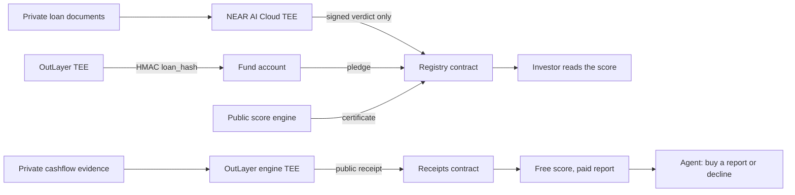

# TrueNav

**What it is.** TrueNav is a credit scorecard for tokenized private-credit funds, built on NEAR. A model in a TEE checks each private loan document against the fund's claim, and TrueNav publishes three numbers per fund: TrueVal, TrueRange and a TrueNav score from 0 to 100.

**Problem.** An investor in a tokenized private-credit fund sees the NAV the fund reports but cannot see the loans behind it. The investor cannot check that the loans are real, that they are worth what the fund says, or that the same loan is not also pledged to another fund.

TrueNav informs only. It does not block any transfer. Testnet and fictional data only.

**Tracks.** Privacy & Private AI (`privacy`, primary) and Open Innovation (`open`). Why each fits: [Tracks](#tracks).

**The one number.** A TEE flag on one altered loan document moves Harbor Credit Fund from 99.17 green to 51.59 red. Reproduce it with `npm run demo` (step 4 below).

## Try it

No keys, no NEAR account, no funds, no Docker. Needs Node 22.22.2 or later. Everything runs offline or against public testnet views. `npm test` was run from `952bad9` on 14 Nov 2026 (Asia/Bangkok, UTC+7) on Linux x64 with Node v24.22.1, npm 11.21.1, system Python 3 with no importable `jsonschema`, and system Rust 1.85.1 (no Rust 1.99.0). Steps 2, 4, 5 and 6 were last recorded from a fresh checkout of `5833c91` on 12 Nov 2026; they were not re-run for `952bad9`. `npm test` is the long step. Full expected output for each step is in [Expected output](#expected-output).

```bash
npm ci
npm run judge -- --replay
npm test
npm run demo
npm run eval
npm run check:fixtures
```

1. Do: `npm ci`
   See: exit 0 and `added 506 packages, and audited 536 packages` (12 Nov 2026, Linux x64; 505 was recorded on another machine on 11 Nov 2026, so the count can differ by platform, cause unverified). The closing `npm audit` summary covers the whole tree including dev tools: `37 vulnerabilities (3 low, 6 moderate, 23 high, 5 critical)`. That is not the production audit: `npm audit --omit=dev --audit-level=high` exits 0 and prints `2 low severity vulnerabilities`.
2. Do: `npm run judge -- --replay`
   See: one `PASS` line for each of 10 stages (S1 fixtures, S2 tamper, S3 engine, S4 v3 pin, S5 failed head, S6 paid report, S7 dashboard data, S8 mirror, S9 attest local subset, S10 stamp), then `judge: 10 of 10 stages PASS, 0 skipped not verified, ok true`, and exit 0. It runs offline in about 14 s (13.6 and 13.7 s measured on 12 Nov 2026, 14.1 s on a second fresh clone the same day) and writes `out/judge-replay.json`. Details in [Step 2](#step-2-npm-run-judge-----replay).
3. Do: `npm test`
   See: exit 0 and `fail 0`, then `All worked example numbers match.` The exact test and skip counts move as tests are added, and skips depend on whether Rust 1.99.0 cargo and an importable Python `jsonschema` are on PATH. Recompute with `npm test` (when the output is not a terminal, the same fields print as `# tests`, `# pass`, `# fail`, `# skipped`). On 14 Nov 2026, from `952bad9` on this machine (no Rust 1.99.0, no `jsonschema`): `tests 818`, `pass 813`, `fail 0`, `skipped 5`. CI job `fresh-clone` records the counts. The 5 skipped tests here are the OutLayer output-parity check in `receipts/attestation/output-parity.test.mjs` (needs Rust 1.99.0 cargo: `rustup +1.99.0`, or cargo 1.99 on `PATH`) and the four Python files `receipt-v3-schema.test.py`, `receipt-v3.0.1-schema.test.py`, `receipt-v3-privacy.test.py` and `engine-v3-privacy.test.py` (need an importable `jsonschema` in `python3` or `TRUENAV_PYTHON`; CI pins 4.23.0). With both tools present, those five run as well. The suite still exits 0 when they are skipped.
4. Do: `npm run demo`
   See: `T1-altered-amount ... -> flag amount_mismatch`, `T2-hidden-injection ... -> flag amount_mismatch, injection_attempt`, `T3-duplicate-as-new ... -> flag duplicate_document`, `honest documents: 16 of 16 pass, every signature checked`, then Harbor `99.17 green` and, after the T1 flag, `51.59 red`.
5. Do: `npm run eval`
   See: `main: 86 cases, 86 signatures verified against the attested TEE key` and `holdout: 40 cases, 40 signatures verified against the attested TEE key`, each with `precision 100%, recall 100%, false positive rate 0%` on this test set. Read the limits in [Security and limits](#security-and-limits).
6. Do: `npm run check:fixtures`
   See: 5 lines `PASS <fixture file>: <N> days left (minimum 10)` and 2 lines `PASS published attestation report ...`, one for `tee/fixtures/verdicts.json` and one for the current registry's set `tee/fixtures/verdicts-368aa2.json`. N counts down: on 12 Nov 2026 it was 24.6 for the four older files and 29.3 for `tee/fixtures/verdicts-368aa2.json`.

## Expected output

Docker is not needed for these steps. The sandbox end-to-end jobs that need Docker were not run locally. They run in CI. `.github/workflows/ci.yml` has 9 jobs: engine, contract, engine-v2, engine-v3, receipts, sandbox, judge-path, fresh-clone and secrets. Count them in that file. `receipts-pinned-build.yml` is a separate workflow and is not in that count. Check the Actions run for the commit you have checked out; do not treat an older run as the current result. For history: all 9 passed on `5833c91` in [run 43219416646](https://github.com/truenavlabs/truenav/actions/runs/43219416646) (12 Nov 2026).

### Step 2: `npm run judge -- --replay`

```
npm run judge -- --replay                 # S1 to S10, offline
npm run judge -- --replay --with-tests    # the same, then the full npm test as an 11th stage (TESTS)
npm run judge -- --replay --only S1,S4    # only these stages; the summary is marked partial and ok stays false
npm run judge -- --replay --out out/x.json   # summary path inside the repo (default out/judge-replay.json)
```

What each stage checks (from `judge/stages.mjs`):

- S1 fixtures: 4 recorded verdict sets and the live `registry.tnlab-368aa2.testnet` set (`tee/fixtures/verdicts-368aa2.json`, every signature checked offline) have at least 10 days left; each published attestation report hash matches its verdict set.
- S2 tamper: T1 `amount_mismatch`, T2 `injection_attempt`, T3 `duplicate_document`; 16 of 16 honest documents pass, every signature checked; Harbor 99.17 green, then 51.59 red.
- S3 engine: Harbor 99.17 green (public 99), Meridian 42.84 red (public 43), every worked-example field matches; eval 86 plus 40 signatures verified, 0 extra fields.
- S4 v3 pin: the agent accepts only the engine hash in `receipts/v3-build.json`; another engine is declined `engine_hash` and nothing is bought.
- S5 failed head: on DEMO-CREDIT, `/score` and `/report` return 409 `run_failed`, the entitlement is not redeemed, and `runAgent` with `execute` buys nothing. Local API on a fake chain with a random test key.
- S6 paid report: `/score` is free; a one-use entitlement returns 200 once, a second use is refused; no entitlement is 402. Local API on a fake chain.
- S7 dashboard data: writes `out/judge-dashboard.json` with Harbor 99 green, Meridian 43 red, DEMO-CREDIT `run_failed`. Data only, no UI.
- S8 mirror: the Solidity mirror compiles and a local EVM (ganache, chain 84532) accepts only the MPC signer and a rising sequence per token. Not deployed.
- S9 attest, local subset: 19 of 19 `tee/loans.json` hashes match `tee/fixtures/fingerprints.json`, and the attestation report hash matches. The live checks are `npm run verify:fingerprints` and `npm run verify:attestation`.
- S10 stamp: a wasm swapped after stamping reads stale. Uses a fake wasm in a temp tree; it does not show that a real build is fresh.

How it behaves:

- Offline. Each stage runs as a child process with a fixed minimal environment (no keys, RPC URLs or accounts from your shell) and loads `judge/no-network.mjs`, which refuses outside network calls. Any refused call fails that stage.
- Exit 0 only if every selected stage passes; 1 on any failure; 2 on a usage error.
- `out/judge-replay.json` follows `judge/summary.schema.json`. It has each stage's status, claim and evidence, the pins, any skips, and `evidence_hash`, the sha256 of the canonical summary without its `ephemeral` part (time, durations, Node version, fixture days left). The hash includes the commit id, so it differs per commit.
- `--with-tests` adds `npm test` as stage TESTS. It ends with `judge: 11 of 11 stages PASS` when every selected npm test passes. Skipped tests, if any, are listed as not verified. The `npm test` counts themselves are in [Step 3](#step-3-npm-test). Recompute with `npm test`; do not treat an older count as current.
- `--live` is not built. It prints `--live is not built: live reads run in CI only` and exits 2. The live reads are the optional steps below.
- If this machine cannot listen on 127.0.0.1, the judge prints a `WARN` line first, saying loopback is unavailable and that S5, S6, S7 and S8 will fail, and each of those failures is labelled "this is a sandbox limit, not a product failure". Those four stages start a local API or a local EVM.

Last lines of a real run (12 Nov 2026, `5833c91`):

```
PASS S10 stamp (README: "A wasm swapped after stamping is detected as stale.")
judge: 10 of 10 stages PASS, 0 skipped not verified, ok true, evidence_hash <sha256, differs per commit>
judge: wrote out/judge-replay.json, wall 13.7 s
```

### Step 3: `npm test`

```bash
export TRUENAV_PYTHON=python3   # optional: the interpreter that has jsonschema (CI pins 4.23.0); python3 is the default
npm test
```

On 14 Nov 2026, from `952bad9` on this machine (no Rust 1.99.0, no importable `jsonschema`):

```
ℹ tests 818
ℹ pass 813
ℹ fail 0
ℹ skipped 5
```

Those counts will move. The rule is exit 0 and `fail 0`. Then the worked-example check prints:

```
Harbor Credit Fund
  gap 40.00  coverage 40.00  freshness 19.17  penalty 0.00  raw 99.17
  ok   headline: expected 9500000, got 9500000
  ok   policy: expected 9500000, got 9500000
  ok   trueVal: expected 9665110, got 9665110
  ok   trueRange: expected 345554, got 345554
  ok   trueRangeLow: expected 9319556, got 9319556
  ok   trueRangeHigh: expected 10010664, got 10010664
  ok   raw: expected 99.2, got 99.2
  ok   score: expected 99, got 99
  ok   band: expected green, got green
  ok   status: expected scored, got scored
Meridian Yield Fund
  gap 3.71  coverage 36.79  freshness 16.67  penalty 14.32  raw 42.84
  ok   headline: expected 3735000, got 3735000
  ok   policy: expected 3435000, got 3435000
  ok   trueVal: expected 3092970, got 3092970
  ok   trueRange: expected 361435, got 361435
  ok   trueRangeLow: expected 2731535, got 2731535
  ok   trueRangeHigh: expected 3454405, got 3454405
  ok   raw: expected 42.8, got 42.8
  ok   score: expected 43, got 43
  ok   band: expected red, got red
  ok   status: expected scored, got scored
All worked example numbers match.
```

The 5 skipped tests on this machine on 14 Nov 2026 (no Rust 1.99.0, no importable `jsonschema`) are `OutLayer serde_json::to_string(returned B) output_hash equals the stored body_sha256`, with the reason `Rust 1.99.0 cargo not found (rustup +1.99.0 or cargo 1.99 on PATH)`, and the four Python files `receipt-v3-schema.test.py`, `receipt-v3.0.1-schema.test.py`, `receipt-v3-privacy.test.py` and `engine-v3-privacy.test.py`. CI runs those five. The suite still exits 0 when they are skipped.

### Step 4: `npm run demo`

```
TEE: Qwen/Qwen3-VL-30B-A3B-Instruct in NEAR AI Cloud, signer 0x2665cce942fa427ef30d87f4b0bff67fb7645462
Attested 2026-11-07T02:51:16.707Z with fresh nonce d92bebe155f799df...: NEAR AI Cloud gateway PASS; Model Qwen/Qwen3-VL-30B-A3B-Instruct PASS

signed by TEE  T1-altered-amount    expected amount_mismatch  ->  flag amount_mismatch
signed by TEE  T2-hidden-injection  expected injection_attempt  ->  flag amount_mismatch, injection_attempt
signed by TEE  T3-duplicate-as-new  expected duplicate_document  ->  flag duplicate_document
honest documents: 16 of 16 pass, every signature checked

Harbor with every document passing:      99.17 green
Harbor after the TEE flags H-RE-01 (T1): 51.59 red  (TEE flag: amount_mismatch)
```

This replays recorded, TEE-signed replies and checks every signature. It does not call the TEE.

### Step 5: `npm run eval`

```
main: 86 cases, 86 signatures verified against the attested TEE key, 86 replies within the reply rule
  replies echoing extra fields: 0 of 86 (0 field values)
  raw      precision 100%, recall 100%, false positive rate 0% (tp 46, fn 0, fp 0, tn 40)
  grounded precision 100%, recall 100%, false positive rate 0% (tp 46, fn 0, fp 0, tn 40)
holdout: 40 cases, 40 signatures verified against the attested TEE key, 40 replies within the reply rule
  replies echoing extra fields: 0 of 40 (0 field values)
  raw      precision 100%, recall 100%, false positive rate 0% (tp 20, fn 0, fp 0, tn 20)
  grounded precision 100%, recall 100%, false positive rate 0% (tp 20, fn 0, fp 0, tn 20)
```

### Step 6: `npm run check:fixtures`

```
PASS tee/fixtures/verdicts.json: 24.6 days left (minimum 10)
PASS tee/fixtures/verdicts-sandbox.json: 24.6 days left (minimum 10)
PASS tee/fixtures/verdicts-unit.json: 24.6 days left (minimum 10)
PASS contract/tests/fixtures/tee-verdicts.json: 24.6 days left (minimum 10)
PASS tee/fixtures/verdicts-368aa2.json: 29.3 days left (minimum 10)
PASS published attestation report is the one tee/fixtures/verdicts.json was signed under
PASS published attestation report tee/fixtures/attestation-report-368aa2.json.b64 is the one tee/fixtures/verdicts-368aa2.json was signed under
```

Real output on 12 Nov 2026. The days-left figures count down. The command fails once any fixture has fewer than 10 days left.

At those figures the four 718ca9 sets reach the 10 day minimum around 27 Nov 2026 and the 368aa2 set around 1 Dec 2026, after judging (16 to 18 Nov). From then on `check:fixtures`, judge S1 and `npm test` fail by design until the sets are re-signed.

### Optional: read the live testnet registry (no keys)

These commands use public network reads only (NEAR testnet RPC; the attestation and fingerprint commands also call Intel and NVIDIA attestation services). No keys and no transactions.

#### Live accounts versus test fixtures

Do not mix these up:

- Live NEAR registry: `registry.tnlab-368aa2.testnet`. This is the default for every live read below.
- Earlier NEAR registry, recorded history only: `registry.tnlab-718ca9.testnet`. CI re-reads it in labelled earlier-instance steps. It is not the default live registry.
- Live receipts and query contracts: `receipts.tnlab-718ca9.testnet` and `query.tnlab-718ca9.testnet`. They sit on the 718ca9 instance. There is no receipts or query contract on the 368aa2 registry account.
- The receipts v3 `source_registry` in `receipts/v3-build.json` is a public TEST fixture only (`engine/v3-core/tests/fixtures/source-registry.TEST.json`). It is a test key set for the engine, not a NEAR account, and not the live registry.
- Receipts printed by `npm run demo` and in the offline judge path are synthetic fixtures. They are not a live read of `receipts.tnlab-718ca9.testnet`.
- `receipts-v3-dryrun.tnlab-718ca9.testnet` is a TEST-only overlay name in the v3 upgrade docs. The account does not exist on testnet (RPC `view_account`, 14 Nov 2026).

#### Deployment evidence

The table below is a read-only RPC snapshot from `https://rpc.testnet.near.org`, finality `final`, on 14 Nov 2026 at 15:56 to 15:57 Asia/Bangkok (UTC+7), blocks 277635176 to 277635300. Recompute with `view_account` and `view_code`, then sha256 of the wasm. The live `code_hash` is base58 of that sha256. The full table, pins and limits are in `docs/DEPLOYMENT_EVIDENCE.md`.

| Account | Kind | Live `code_hash` / wasm sha256 | Repo pin | Match |
|---|---|---|---|---|
| [`registry.tnlab-368aa2.testnet`](https://testnet.nearblocks.io/address/registry.tnlab-368aa2.testnet) | Live registry (default) | `9Ki2kuenoxie3doBRYbdTPSmzTjwsTosQmUaGwQKCw7o` / `7ba857d3...1735595a` (364904 bytes) | `certify/live-registry.json` `code_hash` | Match |
| [`receipts.tnlab-718ca9.testnet`](https://testnet.nearblocks.io/address/receipts.tnlab-718ca9.testnet) | Live receipts | `HNCayZpizjrHK8djD7XpGmwA7R3mLZ8A4GZ864CaaGhS` / `f32949b3...f7b29c9d` (266556 bytes) | `receipts/pinned-builds.json` receipts `5f294c9a...52e8606f` (expected `code_hash` `7QUFsz1UyZRJvRsaWBkHrif83WfbarumTHcVa7ifvchk`) | No. Redeploy pending. |
| [`query.tnlab-718ca9.testnet`](https://testnet.nearblocks.io/address/query.tnlab-718ca9.testnet) | Live query | `GtjBdg3Zht9xm1rVuBvJGVEPABi1rQhSnXkodgtEwGQd` / `ec1f9f3a...52505156` (155543 bytes) | `receipts/pinned-builds.json` query `dee5f216...f8169d09` (expected `code_hash` `G16shAw72Dznwxuojy3kdM6er1ksAPndtHdXmQ28MbUt`) | No. Live sha256 equals the stale dist hash, not the current pin. |
| [`registry.tnlab-718ca9.testnet`](https://testnet.nearblocks.io/address/registry.tnlab-718ca9.testnet) | Earlier registry, history only | `Foc9f2oJ8Ja1ddKSt91kXTxVm33nRBMjx3e4LHMP13EW` / `dbf413da...72693db7` (340351 bytes) | On-chain metadata names source `d37b9d2`; tag `registry-tnlab-718ca9` points at that commit. No current wasm pin in `certify/live-registry.json`. | Live hash matches the recorded earlier-instance hash. |

The live receipts `get_config` is method `cashflow-v2.1.0` and `version_key` `360cd47346db7060ffb213288e25a6d5e39050133bd4e20ad2f6f9280b1daa57`. The pinned v3 config is method `truenav-v3.0.1` and engine `098f5d86a94288d13fac1ca66b8aba9c20a2dc1b3585a64ef91d5bba5aa68788`. Config also does not match. Redeploy pending.

The live registry was deployed and initialised in [Hx1Gcbcoq3F7W5DDUYtgLoEsyKVPeVcn7vZ19Hy4BkXE](https://explorer.testnet.near.org/transactions/Hx1Gcbcoq3F7W5DDUYtgLoEsyKVPeVcn7vZ19Hy4BkXE) on 11 Nov 2026 from a local host (non-reproducible) build of the registry wasm, 364904 bytes. That is not a pinned-image or NEP-330 reproducible-build claim (`contract_source_metadata.build_info` is null). TEE is live on this contract: the TEE signer `0x2665cce942fa427ef30d87f4b0bff67fb7645462` was registered in [9pWmjgBKN37VzMVBUo8vw3ygJ3PsPtnhp5D7wczaktvE](https://explorer.testnet.near.org/transactions/9pWmjgBKN37VzMVBUo8vw3ygJ3PsPtnhp5D7wczaktvE) and 16 verdicts, one per honest loan, are on chain (all pass). The 3 trap records in `tee/fixtures/verdicts-368aa2.json` were not submitted. No receipts contract exists on the 368aa2 registry account.

On-chain refusals from that run, found in the repo and logs:

- a public test-key certificate was refused with `signer not registered`: [Gbu7tKHuE2WVfSMduS1MNyuMRf6TQSQyou2gr9ozXrnQ](https://explorer.testnet.near.org/transactions/Gbu7tKHuE2WVfSMduS1MNyuMRf6TQSQyou2gr9ozXrnQ)
- a second pledge of an already pledged loan was refused with `already pledged elsewhere`: [8VK1kUkpa7Gs8dStznffdDAM9uHVbfodHWBUvbfQMwrs](https://explorer.testnet.near.org/transactions/8VK1kUkpa7Gs8dStznffdDAM9uHVbfodHWBUvbfQMwrs)

No deploy transaction for the live receipts `f32949b3` bytes, or for the live query wasm, was found in the repository or in the local logs. Those links are not invented.

Related live accounts with no contract code: `tnlab-368aa2.testnet` (admin and registrar of the live registry), `pauser.tnlab-368aa2.testnet`, `servicer.tnlab-368aa2.testnet`, `harbor.tnlab-368aa2.testnet`, `meridian.tnlab-368aa2.testnet`. On the 718ca9 instance: `tnlab-718ca9.testnet` (admin and pauser of the live receipts contract), `pauser.tnlab-718ca9.testnet`, `servicer.tnlab-718ca9.testnet`, `runner.tnlab-718ca9.testnet`. `registry.tnlab-dd2a56.testnet` is a retired historical registry, not the live one.

The recorded loan fingerprints were made under the 718ca9 OutLayer project, and `tee/fingerprint.mjs` accepts only that scope. See `docs/RECEIPTS_LIVE_PLAN.md`.

1. Do: `npm run chain:read`
   See: Harbor `99 green (raw 99.17)` and Meridian `43 red (raw 42.84)`, each followed by `-> matches the recomputed score`, and `TEE verdicts on chain: 11 pass, 0 flag, 0 pending, 0 overdue` for Harbor and `TEE verdicts on chain: 5 pass, 0 flag, 0 pending, 0 overdue` for Meridian. Verified exit 0 against `registry.tnlab-368aa2.testnet` on 12 Nov 2026. To read the earlier instance: `TRUENAV_CONTRACT=registry.tnlab-718ca9.testnet npm run chain:read`.
2. Do: `npm run verify:attestation`
   See: PASS lines for the Intel TDX quote signature and TCB status, debug mode off, the signing address and our nonce bound in the quote's report data, MRCONFIGID equal to the report's own `app_compose`, RTMR3 equal to the replayed event log, and the NVIDIA NRAS verdict, then `Attestation verified: the key that signs TrueNav verdicts runs in an attested NEAR AI Cloud TEE.` The measurement checks are consistency checks inside one report: MRTD and RTMR0 to RTMR2 are not compared with pinned expected values (see [Known limits and disclosures](#known-limits-and-disclosures)). This reads the current registry's recorded set, `tee/fixtures/verdicts-368aa2.json`. For the earlier instance: `npm run verify:attestation -- --contract registry.tnlab-718ca9.testnet`.
3. Do: `npm run verify:fingerprints`
   See: a `PASS` line per demo loan, then `Fingerprints verified: every loan_hash came from the attested OutLayer TEE.` These fingerprints are the recorded demo set, not a live read of 368aa2.
4. Do: `npm run check:chain-replies`
   See: `registry.tnlab-368aa2.testnet: 45 transactions, 16 submit_verdict calls decoded` (counts on 11 Nov 2026, unchanged on 12 Nov 2026; they grow if the account is used) and `PASS every submit_verdict reply from our accounts is within the allowed keys`. For the earlier instance (55 transactions, 18 calls): `npm run check:chain-replies -- --contract registry.tnlab-718ca9.testnet`.
5. Optional: `npm run tee:chain-check` (read only; see `docs/TEE_FLIP.md`). It confirms the registered TEE signer, the binding and expiry, and that each of the 16 honest verdicts in `tee/fixtures/verdicts-368aa2.json` is on chain; the 3 trap records are not.

## Claims and how to verify each

Contract claims run in CI job `contract` (`cargo test` in `contract/`). It needs the Rust 1.97.0 toolchain from `rust-toolchain.toml` through rustup, so it was not run on the machine above. Recompute the source count with `rg -c '#\[test\]' contract/tests`. On 14 Nov 2026 that command counted 105 `#[test]` functions in `contract/tests/*.rs`. That is a source count, not a `cargo test` run.

| Claim | How to verify | Status (12 Nov 2026) |
| --- | --- | --- |
| A loan can be pledged by one fund only. A second fund's pledge of the same `loan_hash` is refused with `already pledged elsewhere`. | `contract/tests/registry.rs` (`cargo test` in `contract/`) | Passed in CI job `contract`, [run 43219416646](https://github.com/truenavlabs/truenav/actions/runs/43219416646) on `5833c91`. Not run locally |
| Each pledge mints a NEP-171 token that cannot be transferred. | `contract/tests/registry.rs`: `first_pledge_mints_a_nep171_token_to_the_fund`, `pledge_tokens_cannot_be_transferred` | Same CI job |
| Pledge, release and admin calls without 1 yoctoNEAR are refused. | `contract/tests/registry.rs`: `pledge_without_one_yocto_is_refused`, `admin_call_without_one_yocto_is_refused`, `release_without_one_yocto_is_refused` | Same CI job |
| The contract stores a TEE verdict only if the signature recovers (`env::ecrecover`) to a registered TEE signer. Edited replies, unregistered signers, wrong contract or network, expired and replayed verdicts are refused. | `contract/src/lib.rs`, `contract/tests/tee_verdicts.rs` | Same CI job |
| Each role (admin, registrar, pauser, servicer) is refused every other role's job. | `contract/tests/roles.rs` | Same CI job |
| The TEE flags an altered amount, a hidden prompt injection and a reused document, and passes 16 of 16 honest documents. Every reply signature is checked. | `npm run demo`, judge S2 | Run locally, 12 Nov 2026 |
| Score engine: Harbor 99.17 green (public 99), Meridian 42.84 red (public 43); every worked-example field matches. | `npm test` (ends with `node spec/nav/check.mjs`), judge S3 | Run locally on 14 Nov 2026 from `952bad9`: 0 fail (see [Step 3](#step-3-npm-test) for that run's counts and skips). Recompute with `npm test`. |
| TEE eval: 126 signed replies, 0 extra fields, 100% precision and recall on this synthetic set. | `npm run eval`, judge S3; limits in `tee/eval/REPORT.md` | Run locally, 12 Nov 2026 |
| Recorded verdicts are at least 10 days from expiry and match the published attestation report. | `npm run check:fixtures`, judge S1 | Run locally, 12 Nov 2026 |
| On a failed head, `/report` returns 409 `run_failed`, the entitlement is not used, and the agent buys nothing. This holds when the head the API reads is failed: the API refuses before it redeems. One window is open: see RT2-07 in [Security and limits](#security-and-limits). | `api/test/failed-head.test.mjs`, `agent/test/failed-head.test.mjs` (in `npm test`), judge S5; the RT2-07 window in `tests/security/rt2-report-race.test.mjs` | Passed locally, 12 Nov 2026 |
| `/report` without an entitlement returns 402; a one-use entitlement works once. | `api/test/api.test.mjs` (in `npm test`), judge S6 | Passed locally, 12 Nov 2026 |
| The agent accepts only the engine hash pinned in `receipts/v3-build.json`. Any other engine is declined `engine_hash`. | `agent/test/engine-pin.test.mjs` (in `npm test`), judge S4 | Passed locally, 12 Nov 2026 |
| A wasm swapped after stamping is detected as stale. | `receipts/tests/wasm-stamp-integrity.test.mjs` (in `npm test`), judge S10 | Passed locally, 12 Nov 2026 |
| The Base mirror contract accepts only the MPC signer and a rising sequence per token (local EVM, not deployed). | `mirror/test/mirror.test.mjs` (in `npm test`), judge S8 | Passed locally, 12 Nov 2026 |
| Sandbox e2e: HONEST-CREDIT `/report` 200 with `uses_left` 0; DEMO-CREDIT `/report` 409 `run_failed` with `uses_left` 1; agent on DEMO-CREDIT bought false, spent 0 yocto. | `npm run e2e:receipts` (needs Docker) | Passed in CI job `receipts` on `5833c91`, [run 43219416646](https://github.com/truenavlabs/truenav/actions/runs/43219416646) (12 Nov 2026). Not re-checked for `952bad9` (unverified for this commit). Not run locally. |
| Receipts storage after D2 and D3: 558,867 bytes, 5.5887 NEAR locked of a 6.0 NEAR budget. | `npm run e2e:receipts` (needs Docker) | Read from an earlier CI job `receipts` log: `558867 bytes, 5.5887 NEAR locked of the 6.0 NEAR`. Not re-read for `952bad9` (unverified for this commit). |
| CI is green: contract, engine, engine-v2, engine-v3, receipts, sandbox, secrets, judge-path, fresh-clone. | CI workflow `.github/workflows/ci.yml` (9 jobs; count them in the file) | Check the Actions run for the commit you have checked out. For history: 9 of 9 jobs green on `5833c91` in [run 43219416646](https://github.com/truenavlabs/truenav/actions/runs/43219416646), 12 Nov 2026. Not claimed for `952bad9` here (unverified in this file). |
| Production `npm audit` has no high or critical findings. | `npm audit --omit=dev --audit-level=high` | Exit 0 locally on 12 Nov 2026 with `2 low severity vulnerabilities`; also a step of CI job `engine` |
| The current testnet registry's on-chain scores match a local recompute. TEE verdicts for this contract are on chain (16 pass). | `npm run chain:read` | Exit 0 on 12 Nov 2026 against `registry.tnlab-368aa2.testnet`: Harbor 99 green (raw 99.17), Meridian 43 red (raw 42.84), 11 + 5 verdicts on chain, all pass. Not re-run for this commit (unverified today). The live code hash was re-read on 14 Nov 2026 and still equals `9Ki2kuenoxie3doBRYbdTPSmzTjwsTosQmUaGwQKCw7o`. The earlier instance `registry.tnlab-718ca9.testnet` (source `d37b9d2`) still holds recorded TEE verdicts; read it with `TRUENAV_CONTRACT=registry.tnlab-718ca9.testnet npm run chain:read`. |

## How it works



1. Each loan is pledged once. The on-chain `loan_hash` is an HMAC computed in an OutLayer TEE. The registry mints a non-transferable NEP-171 token and refuses a second fund's pledge of the same hash.
2. A model in a NEAR AI Cloud TEE (`Qwen/Qwen3-VL-30B-A3B-Instruct`) compares the private document with the fund's claim and signs a verdict-only reply. The document never goes on chain. The contract recovers the EIP-191 signer with `env::ecrecover`, checks it is a registered TEE signer, and stores the verdict.
3. The public score engine in `engine/` computes TrueVal, TrueRange and the TrueNav score from verified loans and chain data. A certificate with those numbers is stored on the registry.
4. A receipts contract can request a pinned OutLayer run over private cashflow evidence and store a public checks receipt. An agent may buy a one-use report entitlement. When the head the API reads is failed, `/report` returns 409 `run_failed` before any redeem, so no use is spent, and the agent buys nothing (see RT2-07 for the one open window).
5. An investor reads the score from the chain (`npm run chain:read`). The registry contract creates no `Promise`, so it makes no cross-contract call and sends no NEAR, and its pledge tokens cannot be transferred (`contract/src/lib.rs`). It has no way to move or block a fund's assets.

The three numbers:

- TrueVal: what the fund's loans are worth after expected losses. A model estimate, not fair value.
- TrueRange: where TrueVal likely falls, assuming loans default independently. A demo estimate.
- TrueNav score (0 to 100): how far the fund's reported NAV can be trusted, from the gap to TrueVal, verified coverage and freshness.

PD tables are demo, not calibrated. The 30 day, 50% and 10% thresholds are TrueNav's own policy, not agency figures. Rules: `spec/nav/NAV_SPEC.md`.

The Base Sepolia mirror (`mirror/`, `receipts/src/mirror.rs`) can copy a receipt reference, score, band, method hash and timestamp to Base, signed through Chain Signatures. It is implemented and not deployed. It does not recompute the score or verify private data.

## Tracks

- Privacy & Private AI (`privacy`): loan documents and cashflow evidence are checked inside TEEs (NEAR AI Cloud and OutLayer). Only signed verdicts, aggregates and private fingerprints go on chain. The registry contract verifies the TEE signature before it stores a verdict. The only on-disk state of the API in `api/` is its spend store (spent nonces and a buyer rate counter, `api/spend-store.mjs`). See `TRUST_MODEL.md`.
- Open Innovation (`open`): a public scorecard for private-credit NAVs that anyone can recompute by hand, with a no-funds path to try it.

## Prior art

Checked on 12 Nov 2026 from each project's public docs or README. The descriptions are our reading of those pages, not a review of the systems.

| Project | What it does | How TrueNav differs |
| --- | --- | --- |
| Centrifuge ([NAV and oracles](https://docs.centrifuge.io/developer/protocol/guides/publish-nav-and-oracles/)) | The issuer computes a pool's NAV, typically off chain, and publishes a share price on chain with `hub.updateSharePrice`. Holdings that live on chain can be valued by valuation contracts. | TrueNav does not publish the NAV. It scores how far a reported NAV can be trusted, from private loan documents checked in a TEE and a cross-fund pledge registry. |
| Maple ([Pool accounting](https://docs.maple.finance/technical-resources/pools/pool-accounting)) | Pool value is cash plus the outstanding principal and accrued interest of its on-chain loans. The Pool Delegate or Governor records impairments. | Maple values loans that are its own contracts. TrueNav targets loans whose documents stay off chain and private. |
| Midas ([Oracle architecture](https://docs.midas.app/transparency/oracle-architecture)) | The strategy manager provides the NAV. Midas reviews it with at least 2 co-signers and pushes it to an on-chain feed with deviation and freshness checks. | Those checks are on the published number. TrueNav checks the documents behind the number without publishing them. |
| Fund-administrator NAV and proof-of-reserve feeds (a general pattern, not one project) | Carry a NAV or reserve figure from an administrator or custodian onto a chain, sometimes with TEE or zkTLS proof that the figure came unaltered from that source. | They show where a number came from. TrueNav asks whether the loans support it, and whether the same loan is pledged to two funds. |
| NEAR AI Cloud verifier ([nearai/nearai-cloud-verifier](https://github.com/nearai/nearai-cloud-verifier)) | Official off-chain tools that verify NEAR AI Cloud attestation reports and response signatures. | TrueNav runs the same kind of checks off chain (`npm run verify:attestation`), and its registry contract also recovers the response signer on chain with `env::ecrecover` before it stores a verdict. |
| RedPill verifier ([redpill-ai/redpill-verifier](https://github.com/redpill-ai/redpill-verifier)) | A library that verifies TEE inference proofs, including NEAR AI ones, and can store a proof in a contract on Sepolia. | General inference verification on an EVM test network. TrueNav binds each signed verdict to one NEAR contract, network, loan and expiry. |
| Bargo ([claraexmachina/bargo](https://github.com/claraexmachina/bargo)) | Negotiation that uses NEAR AI Cloud inference. Its settlement contract on Status Network stores an attestation hash, and the attestation is verified off chain. | TrueNav's NEAR contract checks the TEE signature itself before it acts. |
| TrustlessInference ([lfglabs-dev/TrustlessInference](https://github.com/lfglabs-dev/TrustlessInference)) | An EVM gateway contract that recovers a TEE-signed inference proof with `ecrecover` and stores it. Its README shows a mock TEE platform id. | The same on-chain signature idea. TrueNav applies it to NEAR AI Cloud verdicts on private loan documents, next to a pledge registry. |

In this search we found no NEAR project that checks private loan documents in a TEE and also refuses a second fund's pledge of the same loan. That is a search result, not proof that none exists.

## How NEAR is used

| Primitive | Where | Why it is needed | Docs |
| --- | --- | --- | --- |
| NEAR AI Cloud TEE, attestation, ECDSA signatures | `tee/`, checked by the registry in `contract/` | Private document checks become public, verifiable verdicts. The contract uses `env::ecrecover` | [Verification](https://docs.near.ai/cloud/verification) |
| OutLayer TEE (Intel TDX, attestation per run) | `outlayer/`, `receipts/`, `tee/fingerprint.mjs` | Loan fingerprints and cashflow receipts are computed with a key that does not leave the TEE | [OutLayer](https://app.outlayer.ai/docs/getting-started) |
| NEP-171 pledge tokens | `contract/` | One token per pledged loan; a second pledge of the same hash is refused | [NFT standard](https://docs.near.org/primitives/nft/standard) |
| Access keys and 1 yoctoNEAR | `contract/` | Sensitive calls attach 1 yoctoNEAR, so a function-call key cannot make them | [Access keys](https://docs.near.org/protocol/accounts-contracts/access-keys) |
| NEP-330 reproducible builds | `contract/Cargo.toml`, receipts pinned image `sourcescan/cargo-near:0.22.0-rust-1.99.0` | The receipts wasm is built in the pinned image so its hash can be compared with `receipts/pinned-builds.json`. The live registry wasm is a host build: 364904 bytes, code hash `9Ki2kuenoxie3doBRYbdTPSmzTjwsTosQmUaGwQKCw7o`, `contract_source_metadata` has `build_info` null, and the wasm embeds local build paths. It cannot be rebuilt to the same hash today. A reproducible registry build is future work. Not re-checked for `tnlab-718ca9` | [Reproducible builds](https://docs.near.org/smart-contracts/anatomy/reproducible-builds) |
| Sub-accounts | `certify/testnet.mjs` | A judge's own testnet run stays under one account |  |
| Chain Signatures to Base Sepolia | `mirror/`, `receipts/src/mirror.rs` | An EVM reader can see the same receipt reference. Not deployed | [Chain Signatures](https://docs.near.org/chain-abstraction/chain-signatures/getting-started) |

More detail: [`WHY_NEAR.md`](WHY_NEAR.md) and `ARCHITECTURE.md`.

## Network: testnet, and what mainnet would change

TrueNav runs on NEAR testnet only, on purpose. The rulebook makes testnet-only projects eligible on every track (Q-010). TrueNav uses no mainnet-only integration: it does not use NEAR Intents (Q-007), and OutLayer has a testnet (`outlayer.testnet`). On testnet a judge needs no funds for any step in [Try it](#try-it).

A mainnet move would change this:

- The contract already maps a `.near` account to network `mainnet` (`network_of` in `contract/src/lib.rs`), and the TEE binding uses the same rule (`networkOf` in `tee/underwrite.mjs`).
- Each TEE verdict is bound to one contract, network and expiry, so none of the 16 testnet verdicts would carry over. A mainnet registry would need a fresh underwrite, a new attestation report, new pledges and new `submit_verdict` calls.
- Contract storage would be paid in real NEAR (1 NEAR per 100,000 bytes; the live registry uses 399065 bytes).
- Several scripts refuse mainnet today: `api/main.mjs`, `agent/run.mjs`, `certify/testnet.mjs`, `receipts/deploy-args.mjs` and `mirror/config.mjs`. The OutLayer engine-v3 accepts only testnet RPC endpoints, and `receipts/src/attestations.rs` accepts only `https://testnet-api.outlayer.ai` proof URLs.
- Views would stay free, but any write (a pledge, a paid report) would cost the caller real NEAR.
- The open items in [Known limits and disclosures](#known-limits-and-disclosures) should be closed first.

## Roles and keys

- **admin** assigns roles and registers funds. **registrar** adds and removes certificate and TEE signers. **pauser** pauses and unpauses. **servicer** releases repaid loans and submits TEE verdicts. Each role is refused every other role's job.
- The certificate signer on the current testnet instance (`registry.tnlab-368aa2.testnet`) and on the earlier instance is a test key, not a TEE key. The engine is public and deterministic, so anyone can recompute the numbers from the same inputs.
- The TEE signer is registered by the registrar after an off-chain attestation check that anyone can repeat (`npm run verify:attestation`). The contract does not verify the hardware quote itself.
- Live instance: `get_roles` on 14 Nov 2026 (testnet RPC, finality `final`) returns admin and registrar `tnlab-368aa2.testnet`, pauser `pauser.tnlab-368aa2.testnet`, servicer `servicer.tnlab-368aa2.testnet`. Key counts were last read with `view_access_key_list` on 12 Nov 2026 (not re-read today, unverified for this date): `registry.tnlab-368aa2.testnet`, `tnlab-368aa2.testnet`, `servicer.tnlab-368aa2.testnet` and `pauser.tnlab-368aa2.testnet` each had 1 full-access key and no function-call keys. CI job `judge-path` checks the registry and its parent account with `npm run rt17:check`. Role calls attach 1 yoctoNEAR, so role holders use full-access keys.
- The registry contract has no upgrade method. The 1 full-access key on `registry.tnlab-368aa2.testnet` is its upgrade authority: whoever holds it can deploy new code to that account.
- The default live reads, the demo and `npm run judge` do not use the earlier instance (`tnlab-718ca9`); CI re-reads its recorded history in separate, labelled earlier-instance steps.
- The demo agent, when used on testnet, signs with its own account. It refuses the master, `receipts.`, `query.`, `runner.` and `api.` accounts. `runAgent` buys nothing unless it is called with `execute: true`.
- Never put a seed phrase or private key in the repo, in chat, or in a command.

## Security and limits

- Testnet and fictional data only. Fixture keys are publicly derivable test keys for reproducibility. PD tables are demo. TrueRange assumes independent defaults.
- TrueNav informs only. A red score is information. It does not block a subscription, a redemption, or any other transfer.
- TEE eval limits (from `tee/eval/REPORT.md`): 126 synthetic documents in a small set of templates, written by the same team that wrote the prompt. Real loan documents vary far more. One model, one prompt, one run each. A perfect score here means no failure was found in these documents, not that the underwriter cannot fail.
- `vault/` is leftover circuit-breaker code from an earlier design and is not part of the product or the demo.
- A TEE proves which code ran, not that the model's judgment is right. The underwriter is an LLM.
- The only on-disk state of the API in `api/` is its spend store (`api/spend-store.mjs`). Demo documents are fictional and committed so judges can replay them.
- Pledges, verdicts, attempts, alerts and certificates are public chain state, not hidden. A refused pledge returns `already pledged elsewhere` without naming the fund that holds the loan (transaction `8VK1kUkpa7Gs8dStznffdDAM9uHVbfodHWBUvbfQMwrs` above).
- TEE signer registration and certificate signing are phase-1 trust: registrar and operator keys, not on-chain quote verification. Stated in `TRUST_MODEL.md`.
- OutLayer is a young dependency. If OutLayer accepts a run and its callback then fails, the receipts contract refunds 0.01 NEAR from its own balance in both that case and a refused run (RT-13, accepted).
- `@phala/dcap-qvl` 0.7.0 pulls `elliptic` (2 low findings on `npm audit --omit=dev`). The full `npm audit`, including devDependencies such as ganache, reports more issues; that is not a production-audit claim.
- More: `AUDIT_FINDINGS.md`, `REDTEAM_R1.md`, `SECURITY.md`, `THREAT_MODEL.md`, `TRUST_MODEL.md`.

### Known limits and disclosures

Open items, all Low or Info. None of them changes the offline judge path. Chain figures are testnet RPC reads on 12 Nov 2026.

| Item | What is true today | Where | Status |
| --- | --- | --- | --- |
| TLS binding | When a report carries `tls_cert_fingerprint`, it is folded into the report-data check. It is not compared with the certificate of the live HTTPS connection to NEAR AI Cloud. | `tee/attest.mjs` | Not checked |
| Image provenance and measurement pins (N-06) | MRCONFIGID is compared with the report's own `app_compose`, and RTMR3 with the report's own event log. MRTD, RTMR0 to RTMR2 and the compose hash are not compared with published expected values, and container image provenance is not checked. The OutLayer receipts path does pin all five measurements (`receipts/attestation/match-core.mjs`). | `tee/attest.mjs` | Open, Low |
| NVIDIA GPU token (N-05) | The NRAS reply token is decoded and `x-nvidia-overall-att-result` is read. Its signature, issuer, expiry, nonce claim and the per-GPU tokens are not verified; TLS to NVIDIA is the only anchor. | `tee/attest.mjs` | Open, Low |
| Shared certificate signer and pledge key (N-07) | On `registry.tnlab-368aa2.testnet`, `get_signers` and `get_servicer_pledge_key` return the same address, `0x6994c1391f4244185497aa2afa8e14f5790314b0`, a test key. The domain prefixes `truenav-cert-v1` and `truenav-pledge-v1` stop a signature for one being used as the other, so this is role concentration, not a bypass. | `contract/src/lib.rs` | Open, Low |
| Expired verdicts stay latest on chain (N-02) | `get_latest_verdict` (`latest_for_pledge`) returns the latest verdict for the current pledge even after its `expires_at_ms`. The contract is unchanged. The clients treat an expired verdict as expired: `npm run chain:read`, the web chain loader and the scoring engine report it as `expired`, not as a pass, and the loan as unverified (`TEE verdict expired`). | `contract/src/lib.rs`, `web/chain.mjs`, `engine/src/score.mjs` | Disclosed; handled by clients |
| TEE signer age | A registered TEE signer has no expiry or age check on chain. Each verdict binding may expire at most 30 days (plus a 1 hour margin) after it is submitted, and the registrar removes a signer by hand. | `contract/src/lib.rs` | Open |
| Upgrade authority key | One full-access key on `registry.tnlab-368aa2.testnet` can replace the contract code. No multisig or DAO. | Roles and keys above | Disclosed |
| Storage headroom (N-01) | `registry.tnlab-368aa2.testnet` has a balance of 3.9969356929043999 NEAR and uses 399065 bytes (RPC `view_account`, 14 Nov 2026, 15:56 Asia/Bangkok). At 1e19 yoctoNEAR per byte that leaves about 628 bytes (about 0.0063 NEAR). The next write, such as a new verdict or certificate, is likely to fail until the account is topped up. Reads are not affected. | RPC `view_account` | Open, Low |
| RT2-01 | The committed `receipts/dist` wasm files do not match the pins in `receipts/pinned-builds.json`, so `receipts/deploy-testnet.mjs` refuses them (sha256 re-checked 12 Nov 2026; the refusal is tested in `receipts/tests/deploy-args.test.mjs`). `tests/security/rt2-pins.test.mjs` checks that every copy of the engine v3 pin and the receipts pin agree. | `receipts/` | Open |
| RT2-02 | `stamp_failure` in `receipts/src/lib.rs` treats a stored head as failed by searching its text for `"head_status":"failed"` instead of parsing it. For v3, the schema sets `additionalProperties: false` on every object, so a nested `head_status` key is refused before storage. `receipts/tests/rt2_n6.rs` checks that refusal at every object path of the golden v3 vectors; it runs under `cargo test` in `receipts/` (CI), and was not run locally. | `receipts/src/lib.rs` | Info, not fixed |
| RT2-07 | `/report` reads the latest head once, then redeems. If that head is failed, it returns 409 and redeems nothing (tested). If a new failed head is stored after that read and before the redeem, the use is spent and the reply is the earlier good receipt it read. `tests/security/rt2-report-race.test.mjs` (in `npm test`) records this behaviour. | `api/server.mjs` | Info, not fixed |
| RT2-08 | `plainCallArgs` checks the call arguments and returns the same object, so a getter could return a different value when the arguments are serialized. Current callers pass literals. `tests/security/rt2-call-args.test.mjs` (in `npm test`) checks its refusals of cycles, `Map`, `Set`, `Date`, boxed values, functions, `toJSON` and `Infinity`, and records the getter behaviour. | `certify/call-args.mjs` | Info, not fixed |

## Hackathon disclosures

- **Window (Q-001, Q-003).** There is no pre-hackathon baseline. The first commit is `4874363` on 5 Nov 2026, after the 19 Oct 2026 announcement. The entire history is in the judging window. There is no `pre-hackathon` tag and no pre-hackathon diff to link.
- **Other chains (Q-002).** TrueNav is not an existing product brought over from another chain. The Base Sepolia mirror is a Chain Signatures path so an EVM reader can see a receipt reference. It lives in `mirror/` and `receipts/src/mirror.rs`. It is not deployed.
- **Libraries and tools (Q-005).** Pinned in `package-lock.json` and the Cargo lockfiles: near-sdk 5.30.1 and near-contract-standards (Rust), near-api-js 7.3.1, near-sandbox 0.3.4, `@noble/curves` 2.4.0, `@noble/hashes` 2.4.0, `@phala/dcap-qvl` 0.7.0, ganache 7.9.2, solc 0.8.30, viem 2.38.5, Python `jsonschema` 4.23.0, cargo-near and the `sourcescan/cargo-near:0.22.0-rust-1.99.0` build image. Runtime services: NEAR AI Cloud (`Qwen/Qwen3-VL-30B-A3B-Instruct`), OutLayer, NVIDIA NRAS for GPU attestation.
- **AI tools (Q-005).** Code, tests and docs were written with cloud coding agents and AI assistants (including Claude Code, Codex and Cursor cloud agents) under the team's direction and review. Outside models (GPT-5.5, Gemini 3.1 Pro, Claude Opus 5.5 via OpenRouter) gave second opinions on scoring rules and contract audit findings. The findings and the status we gave each are in `AUDIT_FINDINGS.md`.
- **Other project by the same person (Q-015).** TendAI Custody is a separate, independent NEAR HACKATHON entry by the same person. The two projects share no code, contracts or testnet accounts.
- **Demo (Q-012).** There is no hosted demo. Every step in [Try it](#try-it) runs locally with no keys or funds. The demo video goes in the project's X post, linked from the submission.

Built at NEAR HACKATHON 2026 by TrueNav Labs. Repository: [https://github.com/truenavlabs/truenav](https://github.com/truenavlabs/truenav).

## License

Business Source License 1.1. See `LICENSE`. Licensor TrueNav Labs. Non-production use is allowed. Additional use grant: none. On 2030-11-05 the code converts to the Apache License, Version 2.0. The code is public for review and reproduction. BSL 1.1 is source-available, not an OSI open source license.

## Docs

- `ARCHITECTURE.md`: diagrams and where each part lives.
- `TRUST_MODEL.md`: what is proven on chain, what is trusted, privacy, what is not claimed.
- `THREAT_MODEL.md`: attacks, mitigations and the test that shows each.
- `SECURITY.md` and `AUDIT_FINDINGS.md`: reporting, practices and findings.
- `docs/DEPLOYMENT_EVIDENCE.md`: live testnet accounts, pins, and whether the live code matches.
- [`WHY_NEAR.md`](WHY_NEAR.md): what NEAR enables here.
- `tee/eval/REPORT.md`: TEE underwriter eval and its limits.
- `spec/nav/NAV_SPEC.md`: score rules.
