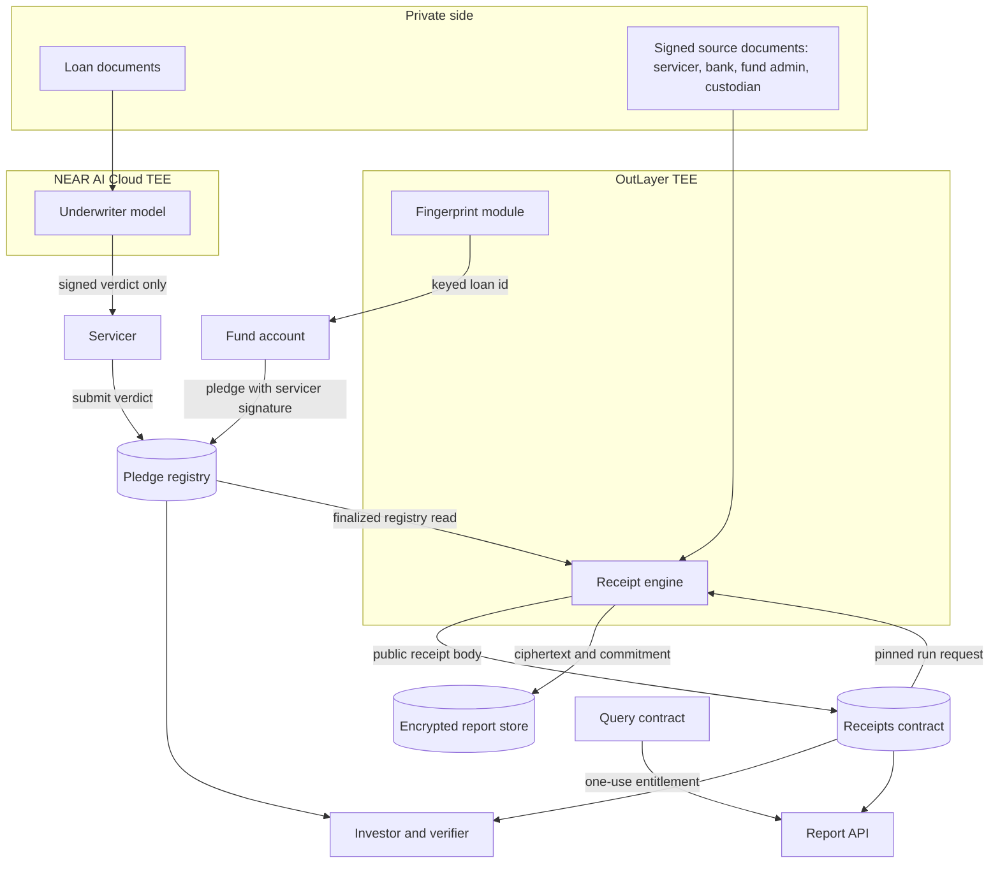
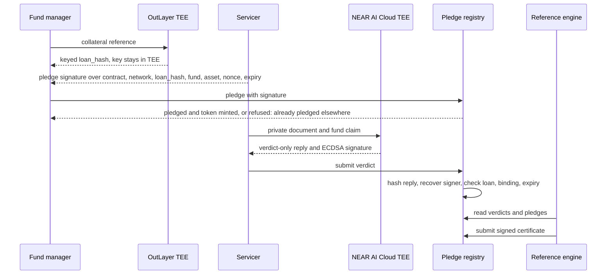
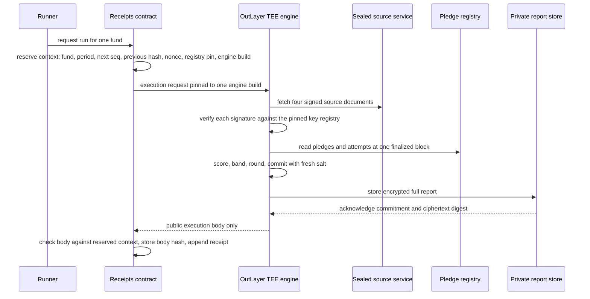

# TrueNav

## Private verification of private credit NAVs on NEAR

TrueNav Labs. Design whitepaper, v2.0, November 2026.

A NEAR HACKATHON entry (nearhackathon.com). Primary track: Privacy and Private AI. Also entered in Open Innovation.

TrueNav runs on NEAR testnet only. Every fund, loan, borrower, bank feed and document used to demonstrate it is fictional.

> **Deployment status at the time of writing (14 November 2026).** The pledge registry, on-chain verification of TEE-signed loan verdicts, and the paid query contract are live on NEAR testnet. The receipts contract live on testnet runs the second-generation (v2) receipt design. The third-generation (v3) receipt design described in sections 5.7 to 5.10 and section 8.3 is fully specified, built and pinned to an exact build hash, and its upgrade has been rehearsed against a copy of the live contract's code, but it is **not deployed** on the live receipts account. Section 11 states exactly what runs where.

---

## Abstract

Tokenized private credit funds ask investors to trust a single number: the net asset value (NAV) the fund reports. The loans behind that number are private, the data that values them comes from the fund's own servicer, the cash that is said to service them is seen only by the fund's bank, and no shared record stops one loan from backing two funds at once.

TrueNav is a verification layer for these funds. It has three parts. First, a NEAR contract keeps a registry of pledged loans under private, keyed fingerprints, and refuses a second fund's claim on a loan that is already pledged. Second, a language model running inside a trusted execution environment (TEE) reads each private loan document, compares it with what the fund claims, and returns a short signed verdict that the contract verifies before it stores it. Third, a scoring engine running inside a second TEE reads source documents that the servicer, bank, fund administrator and custodian have each signed, checks those signatures against a pinned key registry, reads the pledge registry at a finalized block, and publishes one checks receipt per fund and period.

The receipt carries a whole-number TrueNav score from 0 to 100 and coarse public bands. Exact figures stay in an encrypted private report that the receipt commits to with salted hashes. Documents never leave the private side. Verdicts, pledges and receipts are public, bound to one contract and network, and checkable by anyone.

This paper describes the design: the problem, the goals, the threat model, the architecture and protocol, the cryptography, the privacy properties, how a third party verifies each output, the trust that remains, and the known limits.

## 1. The problem

### 1.1 Private credit on chain

Private credit is lending outside public bond markets: loans to businesses, property borrowers and receivables pools, held by funds rather than traded. Tokenization puts fund shares on a blockchain. It does not make the loans any more visible. The investor still holds a claim on private contracts that only the fund, its servicer and its bank can see.

### 1.2 The NAV is a claim

The NAV is computed off chain by the fund or its administrator and then published. Existing on-chain NAV designs focus on carrying that number faithfully, through co-signers, oracle feeds or proofs that the figure arrived unaltered from its source. They show where a number came from, not whether the loans and the cash support it.

Four failures sit underneath the number:

1. **Double pledging.** A loan pledged to one fund is listed again by another. Each fund's investors see a full book. Neither sees the overlap.
2. **Altered documents.** An amount is raised, an asset type is changed, or an old document is reused under a new identifier. No outside reader ever sees the document, so no outside reader sees the change.
3. **Opaque servicer data.** Delinquency, accrued interest and repayments come from the servicer. Stale or inconsistent figures move the NAV quietly.
4. **Yield that is not cash.** A fund can report interest that was accrued or capitalized but never paid, count a sponsor top-up as income, or report collections that its bank never settled.

### 1.3 Why the obvious fix fails

Publishing loan files and bank statements would solve verification and destroy confidentiality, since they name borrowers, amounts, collateral and counterparties. Publishing exact aggregates is not safe either: in a small book, two exact ratios are often enough to solve for a single loan's balance. A useful verifier must run on private inputs, produce an output a stranger can trust, and publish that output at a resolution that cannot be inverted.

## 2. Design goals

1. **Check the loans, not the number.** Verification happens at the level of each loan document, each pledge and each cash settlement. The fund score is derived from those checks.
2. **Keep documents private.** Loan documents, loan tapes and bank feeds are read only inside attested hardware. They are never published or stored on chain.
3. **Authenticate every input.** Each source document carries a signature from a key whose role, fund scope and validity window are fixed in a pinned registry. An unsigned or unknown input cannot produce a score.
4. **Make every result checkable.** A verdict is accepted only with a signature the contract verifies. A receipt is bound to one request, one pinned engine build and one position in an append-only history. Anyone can check the binding.
5. **One loan, one fund.** A shared registry makes a second pledge of the same loan visible and refused, and a receipt reports any conflict it finds.
6. **Publish at a safe resolution.** Public money figures are rounded on a fixed ladder, ratios are banded, small counts are suppressed, and exact values are committed to rather than published.
7. **Inform, do not control.** TrueNav publishes information. It never blocks a subscription, a redemption or a transfer, and its contracts hold no fund assets.
8. **Name the trust boundary.** Every trusted component is named, and each rollout phase narrows the set.

## 3. Threat model

### 3.1 Assets

- The confidentiality of loan documents, loan terms, borrower and collateral identifiers, bank transactions and exact fund figures.
- The integrity of the pledge registry: one active first-lien pledge per loan.
- The integrity of each public output: a verdict, a certificate or a receipt says what the attested process produced, for the fund and period it names, and has not been edited, replayed or reordered.

### 3.2 Adversaries

- **A fund manager** who wants a better score than the book supports: by double pledging, altering documents, inflating tape figures, hiding late loans, presenting accrued interest as cash, renaming a fund or a loan to escape history, or feeding the verifier stale data.
- **A rival fund** that wants to damage another fund's score: by attempting to pledge its loans, submitting adverse verdicts or listing its tokens.
- **A curious observer** who reads all public state, transaction arguments and receipts, and wants to recover private figures, link a document to a loan, or re-identify a borrower.
- **A network or relay party** that can delay, drop, replay or reorder messages, or present outputs from another contract, network or deployment.
- **A holder of a leaked key** for one role, such as a function-call key or a single role account.

### 3.3 Out of scope

- A fund and its servicer, bank, administrator and custodian colluding to sign consistent false source documents. Signatures prove origin, not truth.
- Breaks of the TEE hardware or of the attestation vendors' roots of trust.
- Breaks of SHA-256, HMAC-SHA256, secp256k1 ECDSA or Ed25519.
- Legal enforceability of a pledge. The registry is a shared record among participating funds, not a global lien search.

Section 10 lists the components that must be trusted, and section 12 lists the known limits of each defence.

## 4. Architecture

### 4.1 Actors

- **Fund manager.** Holds the fund's NEAR account, pledges its loans and supplies the fund's claims.
- **Servicer.** Authorizes pledges with its signature, submits TEE verdicts, releases repaid loans, and signs loan tapes. The design assumes an independent servicer. On testnet, TrueNav Labs operates this role.
- **Bank, fund administrator and custodian.** Each signs the source document it is responsible for: bank settlements and balances, fund NAV fields and issuer claims, and loan terms with lien rank.
- **TEE underwriter.** An open-weight vision-language model served by NEAR AI Cloud inside Intel TDX with NVIDIA confidential computing. It reads one document and one claim and signs a verdict.
- **Fingerprint service.** An OutLayer TEE module that derives each loan's on-chain identifier with a key that is derived inside the TEE and never exposed.
- **Pledge registry.** A NEAR contract that stores pledges, verdicts, blocked attempts, alerts, signers and score certificates.
- **Scoring engine.** A deterministic program. A public reference version computes registry certificates. The receipt version runs inside an OutLayer TEE at a pinned build.
- **Receipts contract.** A NEAR contract that requests a pinned engine run per fund and period and stores the public receipt it returns.
- **Query contract and report API.** A paid entitlement for a one-use report, separate from scoring.
- **Investor, agent and verifier.** Anyone who reads scores and evidence and re-checks signatures, attestations and hashes.

### 4.2 Components and data flow

Only keyed loan fingerprints, signed verdicts, pledge records, certificates and banded receipts with salted commitments cross into public state.

## 5. Protocol

Sections 5.1 to 5.6 describe the registry path, which is live on testnet, except that the loan identity scheme of section 5.1 is part of the v3 design. Sections 5.7 to 5.11 describe the receipts path in its v3 design, which is not deployed.

### 5.1 Loan identity

Each loan needs a stable on-chain identity that does not reveal it, and that cannot be changed by cosmetic edits.

The identity is a keyed MAC computed inside an OutLayer TEE over a length-prefixed frame with domain tag `truenav-fp-v4`: the asset class, the collateral namespace (a land registry, jurisdiction or issuer) and the document root of the collateral reference. The MAC key is derived inside OutLayer from its master secret, bound to one project, to the calling account and to a fixed key path. In the design the calling account is the receipts contract for every fund, so a fund's own payment key derives a different key and cannot mint identities the engine will recognize. The module asks the TEE host for the MAC and never holds the key.

The document root is a normalized form of the reference: Unicode compatibility normalization, case folding, removal of whitespace, control characters and default-ignorable characters, and a fold of common Cyrillic and Greek letters that copy Latin shapes. Suffixes such as `-copy` are not stripped, and one reference in two namespaces stays two loans. A namespace that the deployment declares case-sensitive keeps its case. Borrower, principal and dates are outside the identity, so a one-cent edit, a renamed borrower or a principal split across two borrower ids cannot mint a new identity for the same collateral.

Each fingerprint request carries a random nonce, so the input hash in the run's public attestation cannot be matched against guesses.

The loans currently pledged on the live testnet registry carry fingerprints from an earlier scheme (asset type and a canonical document identifier, under an earlier key scope). Moving them to the scheme above requires releasing and re-pledging them. Section 11 gives the status.

### 5.2 Pledging

To pledge a loan, the fund calls the registry from its own registered account. The call carries a signature from the servicer's registered secp256k1 key over a message the contract builds itself:

`truenav-pledge-v1 | contract | network | loan_hash | fund account | asset type | nonce | expiry`

The contract checks that the signature recovers to the servicer key, that the expiry is in the future and no more than 24 hours ahead, that the caller is the fund named in the message, that the fund is registered, and that this exact message has not been used before. On the first pledge of a `loan_hash`, the registry locks the loan to the fund and mints a NEP-171 token to the fund's account. Pledge tokens cannot be transferred. They are burned when the servicer releases a repaid loan.

The registry also supports optional pledge tickets. Once the registrar registers a ticket signer, together with the hash of that signer's OutLayer attestation evidence, every later pledge also needs a ticket signature over the same message. The fingerprint module can compose and sign that ticket from the loan hash it has just computed. It never signs caller-supplied bytes. No ticket signer is registered on the live registry today.

### 5.3 Double-pledge refusal, attempts and alerts

When a different fund presents a valid, servicer-signed pledge for a loan that is already locked, the registry refuses it with `already pledged elsewhere`. The refusal does not name the holder.

Because the refusal is a normal return value, not a failed transaction, the registry can record it: each such refusal stores one blocked attempt and one alert under the fund that tried. The holder's record is untouched, so a rival cannot damage a fund by attempting to pledge its loans. A pledge whose caller is not the fund named in the servicer's signature is refused without storing anything, so no one can write to another fund's record.

Blocked attempts feed the score as a penalty on the attempting fund (section 6.4).

### 5.4 Private document review

The servicer sends the document and the fund's claim to the underwriter in NEAR AI Cloud over TLS. The model treats the document as data and checks six things: identifier, asset type, amount, duplicate or re-issued document, instructions aimed at an automated reviewer, and readability.

The reply is a fixed, verdict-only JSON object: the loan hash, a binding string, `ok` or `fail` for each check, an optional evidence line number for a duplicate, the verdict (`pass` or `flag`) and anomaly codes. It carries no document text. Evidence is a line number, never a quote.

NEAR AI Cloud signs every response with an ECDSA secp256k1 key held inside the attested enclave. The signed text is `model_id : sha256(request) : sha256(response)`, wrapped in the EIP-191 personal message format. The request hash commits to the full request, including the private document. The response hash commits to the exact reply.

### 5.5 On-chain verdict verification

The servicer submits the reply, the request hash and the signature. The registry:

1. refuses a reply larger than 4,096 bytes, or one whose message holds anything outside the allowed keys and value types, or any repeated JSON key;
2. requires the loan to be pledged;
3. hashes the response body itself and refuses a response it has already accepted;
4. recovers the signer with NEAR's `env::ecrecover` and requires a registered TEE signer for that model;
5. requires the reply to name the same `loan_hash`;
6. requires the binding `truenav-verdict-v1 | this contract | this network | expiry`, with an expiry that has not passed and is no more than 30 days plus one hour ahead;
7. requires the verdict and the anomaly codes to agree.

Every verdict is kept and the latest one on the current pledge counts. A flag clears only with a later pass from a different request, and a loan's flag history stays public.

### 5.6 Registry scoring and certificates

The public reference engine reads verdicts and pledge times from the registry and computes each fund's figures (section 6). A flagged loan is unverified and excluded. A loan with no verdict is pending for 7 days after its pledge and unverified after that. An expired verdict is treated as expired, not as a pass. The result is signed as a certificate (section 7.5) and stored on the registry.

### 5.7 Checks receipts: request and inputs

A checks receipt is one public record per fund and reporting period, produced by the scoring engine inside an OutLayer TEE. The flow below is the v3 design.

1. **Request.** A runner listed by the contract admin asks for a run. The contract, not the caller, builds the whole request: the fund and its bound NEAR account, the period, the next sequence number and the previous receipt hash, any correction reference, a contract-generated request id and nonce, the hash of the pinned source key registry, and the engine build. It allows one pending request per fund.
2. **Pinned execution.** The contract asks OutLayer to run one engine build, named by its exact hash. The sealed credentials that let the engine reach the source service are locked to that build and are usable only through runs that the receipts contract requests on behalf of its listed runner. Another build cannot read them.
3. **Signed sources.** The engine fetches four documents itself: the servicer's loan tape, loan terms and cashflow records; the bank's settlement feed and balance; the fund administrator's NAV fields and issuer claims; and the custodian's loan terms with lien rank. Each is a signed source envelope (section 7.3). The engine checks every signature against the pinned public registry before it reads any financial field. A failed signature yields a receipt with status `verification_failed`, no score and a closed reason code. An unknown key id stops the run without a public body, so untrusted identifiers are never echoed.
4. **Cross-checks.** Canonical loan terms must appear identically in the servicer's row and the custodian's record. A tape principal or origination date that differs from the signed terms raises the public exception `terms_mismatch`. A fund that claims attested cash must be backed by a signed bank balance of the same amount and as-of time, or the run fails.

### 5.8 Checks receipts: registry read and pledge result

The engine recomputes each loan's keyed identity from the signed terms and reads ownership and blocked attempts from the pledge registry at one finalized block hash. A lock counts as the fund's own only if it names both the fund's registered token and its account.

- **Pledge result.** `conflict` if any completed read shows a lock held by another fund, at any lien rank. Otherwise `unknown` if any loan has lien rank 2 or more (second liens are not supported and are held, not cleared). Otherwise `incomplete` if any read did not complete. Otherwise `clear`. A refused attempt on an otherwise clean book is not a conflict, but its penalty and its 30-day no-green rule still apply.
- **Read coverage.** The share of open in-scope loans with a completed read, floored to 25 percentage points when fewer than ten reads completed and to 1 percentage point otherwise. Partial coverage never rounds up to complete.
- **Attempts.** Distinct refused pledge events from the period start to the valuation time, published as zero, one or two or more. The scoring penalty uses the full history with its decay.

### 5.9 Checks receipts: score, sealing and acceptance

The engine computes the NAV score of section 6 on exact internal values, then applies caps. The cash checks of section 6.6 contribute red-flag caps only. A confirmed pledge conflict adds the cap `pledge_conflict`. Any cap, or a `terms_mismatch`, holds the final score at 59 or below. A conflict or a terms mismatch makes the band red.

It then builds two objects:

- **The private full report**: exact NAV figures, exact score and score parts, the loan tape, cash evidence and matches, pledge detail, the registry read manifest, the source policy, and a fresh 32-byte salt drawn from TEE entropy.
- **The public execution body**: identity and context fields, the receipt's bands and rounded figures (section 8.3), the source key ids with their signature results, and salted commitments to each private part (section 7.4).

The engine encrypts the full report inside the TEE under a dedicated OutLayer key path, with associated data that binds the network, the receipts contract, the fund, the request nonce and the full-report commitment. An authenticated report store must acknowledge both the commitment and the ciphertext digest before the engine emits any public output. The engine prints the public body and nothing else. A failure collapses to a fixed code with no source text.

The receipts contract accepts the body only if its method, network, contract, fund, fund account, period, sequence number, previous hash, nonce and engine hash all match the context it reserved, and the body passes the closed schema. It stores the SHA-256 of the canonical body as a separate binding, adds the issue time, and computes the receipt digest over the complete public envelope.

### 5.10 History, corrections and attestation records

Receipts form an append-only chain per fund. Each receipt names its sequence number and the digest of the receipt before it. When a fund moves from the v2 format, its first v3 receipt continues the v2 sequence and links to the last v2 digest. A correction supersedes the current receipt for the same period with a closed reason code and appends a new sequence number. Old receipts are never edited.

The receipt's own attestation reference stays null by design, so the receipt digest never depends on later evidence. Instead, a designated relayer may append attestation records that link a receipt and its body hash to a public OutLayer proof locator. Records are storage-funded, append-only, idempotent on exact retries, capped per receipt and per writer, and cannot be deleted or rewritten. A record is a locator, not a verdict. Section 9.4 describes how a verifier turns it into an attested status.

### 5.11 Paid reports and agents

Scoring and payment are separate contracts. Reading a fund's score is free. An investor or an automated agent can buy a one-use report entitlement from the query contract for a fixed testnet fee, valid for 24 hours. The report API checks the entitlement before it serves a report and spends it once. A payment never reaches the score path, so paying cannot change a score.

When the current receipt for a fund is a failed run, the API refuses the report before it redeems the entitlement, so no use is spent. The demonstration agent reads the free score, checks the stored receipt against its digest and index fields, accepts only the pinned engine build, and then declines on red, sends any hold or cap to review, and approves only green with no caps and no holds.

## 6. Scoring model

All money is handled in integer cents. Score parts are computed internally at full precision.

### 6.1 Inputs

For each loan, exposure at default is **EAD = principal + accrued - repaid**. Probability of default (PD) comes from the delinquency bucket and loss given default (LGD) from the asset type:

| Bucket (days past due) | PD |
| --- | --- |
| current | 2% |
| 1 to 30 | 10% |
| 31 to 60 | 25% |
| 61 to 90 | 45% |
| over 90 | 100% |

| Asset type | LGD |
| --- | --- |
| First-lien real estate | 31% |
| Invoices (unsecured) | 67% |

These tables are fixed demonstration values, not calibrated to a loss history.

A loan is **verified** when it is open, valid, pledged to this fund on chain, carries a current TEE pass, has no anomaly flag and is not a duplicate. Everything else is unverified.

### 6.2 TrueVal and TrueRange

**TrueVal** is what the verified loans are worth after expected losses:

TrueVal = sum over verified loans of EAD x (1 - PD x LGD)

**TrueRange** is the band TrueVal is likely to fall within, assuming loans default independently:

TrueRange = 1.96 x sqrt( sum of EAD^2 x LGD^2 x PD x (1 - PD) )

The range runs from TrueVal - TrueRange to TrueVal + TrueRange. TrueVal is a model estimate, not fair value, and TrueRange is a model range, not a confidence interval.

**Policy NAV** is the sum of the fund's own marks on verified loans, each counted at most at its EAD.

### 6.3 The TrueNav score

The score measures how far the reported NAV can be trusted. It has three pillars.

- **Gap (up to 40).** The loan-implied headline (LIH) is the reported NAV plus liabilities minus attested cash. Over = max(0, LIH - high end of the range). Under = max(0, low end - min(LIH, Policy NAV)). Points = 40 x max(0, 1 - max(over, under) / (10% x TrueVal)).
- **Coverage (up to 40).** Points = 40 x min(1, Policy NAV / max(LIH, listed book)). Unverified loans, and value the fund reports but does not list, reduce coverage.
- **Freshness (up to 20).** Points = 20 x f(age), where f is 1 at 24 hours or less and falls linearly to 0 at 168 hours. Age is the oldest of the servicer data, the NAV report and the certificate data.

raw = gap + coverage + freshness - penalty

The score is max(0, raw) rounded half up. Bands: **green** 85 and above, **yellow** 60 to 84, **red** below 60.

### 6.4 Penalty for blocked attempts

Each distinct blocked pledge attempt costs:

penalty = 15 x 0.5^(age in days / 30)

Penalties stack linearly and halve every 30 days. The attempting fund always takes the penalty and cannot score green for 30 days after an attempt. Other funds of the same manager receive a warning, and the penalty extends to them when the attempting fund is a shell, when the manager repeats the attempt within 90 days, or when a penalty drives a fund's raw score to zero.

### 6.5 Guard rails

A fund whose unverified value exceeds 50% of its book is disclaimed and shown red with no number. Stale certified data fails verification. Obligor concentration is flagged without changing the score. The 10%, 30-day and 50% thresholds are TrueNav policy, not agency standards.

### 6.6 Cash checks

The receipt engine compares three views of each period's cash: what was contractually due, what the servicer reports as paid, and what the bank actually settled. A claim counts as settled only when a bank credit from the mapped payer for the same amount posts within two days before to five days after the claimed payment date. Duplicates and reversals are removed first. Unlinked credits, security deposits, sponsor transfers, loan proceeds and refunds never count as income.

From this match the engine derives cash match, cash yield against reported yield, collection against contractual dues at a fixed cutoff, and the share of exposure more than 60 days late. In the v3 design these checks contribute caps, not weight. Any of the following holds the score at 59 or below:

- no fresh bank-sourced evidence (`self_reported_only`);
- reported yield at least 3 percentage points above cash yield (`yield_gap`);
- a payout funded by a sponsor transfer (`distribution_funded_by_sponsor`);
- more than 2% of claimed cash never settled by the bank (`claimed_not_settled`);
- less than 90% of contractual dues bank-confirmed by the cutoff (`collection_shortfall`).

A period whose collection cannot be verified yet, or in which nothing fell due, is held at yellow or below rather than scored green.

### 6.7 Worked example

Two demonstration funds show the model. Harbor Credit Fund has every loan verified and recent data, and scores 99.17, published as 99 (green). When the TEE flags one altered amount in one of Harbor's documents, that loan drops out of TrueVal and coverage, and the score falls to 51.59 (red). Meridian Yield Fund carries one blocked attempt, made when it tried to pledge a loan Harbor already held, and one loan excluded on a servicer data anomaly, and scores 42.84, published as 43 (red). Without the attempt penalty Meridian would score 57.17. Under the v3 receipt format the same funds publish 99 green and 43 red, and the two-decimal values stay in the private report.

## 7. Cryptographic design

### 7.1 One signature format on the registry

Verdicts, pledges, tickets and certificates use EIP-191 personal messages over secp256k1. The contract computes keccak256 of the prefixed message, recovers the public key with `env::ecrecover`, derives the 20-byte address and compares it with a registered signer. Each message type has its own domain prefix (`truenav-verdict-v1`, `truenav-pledge-v1`, `truenav-cert-v1`), so a signature made for one purpose never verifies as another.

### 7.2 Binding a verdict to its context

A TEE signature proves the attested model produced a reply. The binding inside the reply ties it to this registry, network and version, for a limited time. The contract derives the network from its own account name (`.testnet` or `.near`), so a verdict cannot be replayed on another network or deployment. Each response hash is accepted once. The request hash commits the verdict to the exact input the model saw, so an auditor holding the document can confirm which document a verdict was about.

### 7.3 Source signatures

Each source document is signed with Ed25519 over the 32 raw bytes of SHA-256 of a length-prefixed frame:

`truenav-src-v1 | source role | key id | scope | period | revision | data as-of | sha256(canonical payload)`

Every field is a 4-byte big-endian length followed by its bytes. The scope names the network, the receipts contract, the fund account and the fund; the period names its start and end dates; payloads are canonical JSON (RFC 8785). Text encoding, canonical form, valid dates and the absence of duplicate keys are checked before the signature.

The public key registry lists, for each key, its id, its role (servicer, bank, fund administrator or custodian), the funds it may sign for (no wildcards), its validity window and its revocation state. The contract pins the SHA-256 of the canonical registry per fund, and the sealed engine profile carries the same registry. A key id is never rebound to a different public key; a changed key gets a new id. Fixture and live registries are never mixed.

### 7.4 Salted commitments

Each private part of a receipt is committed to as

H(label, value) = SHA-256( LP("truenav-v3") || LP(label) || LP(request nonce) || LP(salt) || LP(canonical JSON of value) )

where LP is a 4-byte big-endian byte length followed by the bytes, the nonce and salt are 32 raw bytes, and labels come from a closed list (inputs, tape, cash, NAV report, pledge detail, registry state root, full report, and one label for each exact NAV figure and each exact score field). The salt is fresh per run and per correction and is drawn from TEE entropy, never derived from public data. Without the salt, a commitment reveals nothing that can be tested by guessing. With the private report, an authorized reader can open every commitment.

### 7.5 Keyed MACs inside the TEE

Two kinds of identifier are keyed MACs computed by the OutLayer host under keys derived inside the TEE: loan identities (section 5.1) and the pseudonyms that link servicer records to bank counterparties during the cash match. No name, address, tax id or account number leaves the enclave. The same key scope is used for every fund so that identities remain comparable across funds and across runs, and a rotation of source keys never rotates these keys.

### 7.6 Certificates and receipt digests

A registry certificate signs every field of a fund's result (identity, status, score, band, TrueVal, TrueRange, Policy NAV, headline NAV, blocked attempts, times and engine version) in canonical order, with the registry's account id. Its signing time must increase per fund, so an older result cannot replace a newer one. A fund is bound to one account and one manager, so it cannot rename itself to escape its history.

A receipt digest is SHA-256 over the canonical public envelope, excluding only the digest field itself. The execution body that the TEE attests excludes the digest, the attestation reference and the issue time, so there is no self-reference.

### 7.7 Access control

The registry separates four roles: admin (roles and fund registration), registrar (certificate, TEE and ticket signers), pauser and servicer. Each role is refused the others' functions. Every role call and every pledge requires exactly 1 yoctoNEAR, which a NEAR function-call key cannot attach, so only a full-access key can make it. Certificate submission is gated by the certificate signature. A pause switch stops writes and never stops reads. The registry makes no cross-contract calls and transfers no tokens of value. The receipts contract follows the same pattern for its admin and pauser, accepts run requests only from listed runners, and requires a paid deposit on every run, which a function-call key also cannot attach.

## 8. Privacy properties

TrueNav is not zero-knowledge. Private inputs are processed in attested hardware, and only fixed, minimal outputs become public.

### 8.1 What stays private

- Loan documents, read only inside the NEAR AI Cloud TEE over TLS.
- Loan tapes, loan terms, bank feeds and fund administrator data, read only inside the OutLayer TEE.
- The MAC keys for loan identities and pseudonyms, derived and used only inside the OutLayer TEE.
- Document text in verdicts. The reply format has no field that can carry it.
- In the v3 receipt design: exact NAV figures, exact score and score parts, per-loan rows, cash totals, exposure denominators and the salt, all held only in the encrypted private report.

### 8.2 What is public on the registry

- Each `loan_hash`, the fund holding it, the pledge time, and the pledge token, whose metadata includes the asset type.
- Every verdict with its anomaly codes, request and response hashes, signer, expiry and time.
- Blocked attempts and alerts per fund. They do not name the other fund.
- Certificates with exact fund-level totals: TrueVal, TrueRange, Policy NAV and headline NAV.
- The full signed reply submitted with each verdict, as transaction data.

### 8.3 What a v3 receipt publishes

The v3 receipt is a closed schema. Any field not listed in the schema is rejected, including in nested objects and in the extension slot, which must be empty.

- **Rounded NAV.** Reported NAV, TrueVal and both TrueRange ends, each rounded on a fixed 1-2-5 ladder: the step is the smallest of 1, 2 or 5 times a power of ten dollars that is at least $10,000 and at least one thousandth of the value, and ties round away from zero. The step depends only on the value's order of magnitude, never continuously on the value.
- **NAV result and bands.** Whether the reported NAV sits inside, above, below or on both sides of the range, the size of the gap in coarse bands, and the unverified share in coarse bands. Each band is computed on exact internal values.
- **Cash bands.** Cash evidence status, cash match, yield gap, collection rate and late share, each as a band with fixed edges, and exceptions as closed codes with severity bands. No dollar amount appears anywhere in the cash output.
- **Cohorts with suppression.** Counts of late loans in four delinquency cohorts. A positive count below five is shown as fewer than five, and when any cell is small, the other cells are suppressed too, so no small cell can be recovered by subtraction.
- **Pledge facts.** The pledge result, read coverage on its floors, the number of loans checked in bands (zero, fewer than five, 5 to 9, 10 to 19, 20 to 49, 50 or more), and blocked attempts as zero, one or two or more.
- **Score.** A whole-number score, a band, coarse bands for each score part, a freshness band, and closed cap and hold codes. The two-decimal score, the exact parts and the raw total are private and committed to.
- **Provenance.** Method version and method hash, engine build, source key ids with their signature results, the finalized registry block it read, the request context, and the salted commitments.

The disclosure rules are checked by an observer model that takes every public field of a receipt, together with its predecessors and corrections, and computes the tightest interval each hidden quantity is confined to. A change that narrows any interval below its documented bound is rejected. This is a regression model against the inference rules it encodes, not a proof against every form of outside knowledge.

### 8.4 Inherent leakage

1. **A document holder can link a document to its verdict.** The registry's request hash commits to the full request with no salt. A party that already holds a loan document can rebuild the request, match it to a loan, a fund and a verdict, and recover the claimed amount by search. The document stays private from everyone who does not already have it.
2. **Fingerprints can be guessed by an authorized caller.** The MAC key never leaves the TEE, but a party allowed to request fingerprints can request one for a guessed asset class, namespace and reference and compare it with on-chain loan hashes.
3. **Exact totals reveal small books on the registry.** Registry certificates publish exact fund totals. A fund holding a single loan reveals that loan's figures through them. The v3 receipt rounds and bands these values for this reason, but a singleton or very small aggregate still narrows what an observer knows, and the observer model measures how much.
4. **Intended score signals.** A whole-number score with its part bands still constrains the private parts. A fund with zero unverified share reveals that its coverage pillar is at its maximum. These are accepted, measured disclosures, not accidents.
5. **Metadata.** Reply token counts in signed verdicts indicate document length and cannot be stripped, because the signature covers the whole reply. Pledge, verdict, attempt and receipt times, each loan's asset type, the number of pledges per fund, and the timing of corrections are public.
6. **Operators see inputs.** The party that requests a fingerprint sees the reference it submits. The operator of the sealed source service and the report store holds the private data it serves or stores.
7. **History cannot be re-hidden.** Anything already published on chain, including receipts in earlier formats, stays public.

## 9. Verification

Every public output can be checked by a party with no keys and no funds, using public NEAR views, the published attestation report and the public OutLayer proof routes.

### 9.1 Pledges and attempts

Read the registry's pledge holder per loan, its pledge token events, and the attempt and alert counts per fund. A refused double pledge is a recorded transaction with the `already pledged elsewhere` result.

### 9.2 Verdicts and the TEE signer

For each verdict, recompute the response hash from the reply in the transaction arguments, rebuild the EIP-191 message, recover the signer and compare it with the registered TEE signer. Then check the published attestation report for that signer: the Intel TDX quote signature and TCB status, debug mode off, the signing address and a fresh nonce bound in the report data, the configuration and runtime measurements consistent with the report's own compose file and event log, and the NVIDIA GPU verdict. The hash of that report is stored on chain with the signer. Decode every verdict transaction and confirm that each reply holds only the allowed keys.

### 9.3 Scores and certificates

Recompute each fund's figures with the public reference engine from the chain data and the published inputs, and compare them with the stored certificate and its signature.

### 9.4 Receipts

For a v3 receipt, a verifier anchors the receipt and its predecessor in finalized contract views, validates the closed schema selected by the method version, recomputes the digest, checks the method hash and the engine pin, checks the sequence number and the previous digest, and checks that each source key id is valid in the pinned registry for that fund and time.

To reach an attested status, the verifier fetches the public OutLayer proof named by an attestation record and checks: the Intel quote is genuine and up to date; the TDX task commitment in the report data covers the expected engine build, the original request input, the original NEAR signer and project, and an output hash equal to the stored body hash; every worker measurement is on the approved list; and the quote time falls between five minutes before and sixty minutes after the receipt's valuation time. No record, or any missing evidence, yields `unavailable`, never `attested`. A stored locator alone is never treated as attestation.

Full financial recomputation requires the private report and its salt, which only an authorized reader holds. With them, the reader can open every commitment and repeat the engine's arithmetic.

### 9.5 Deployed code

For each live account, compare the on-chain code hash with the published build hash. The receipts and query contracts are built in a pinned build image so their hashes are reproducible. Section 11 lists which accounts match.

### 9.6 What each check proves, and what it does not

A recovered TEE signature proves that the attested model answered a request with that hash. It does not prove which prompt or policy was in the request, that the model judged correctly, or that the servicer submitted every run it made. An OutLayer attestation proves that the pinned engine build ran on the stated public input and produced the stored body. It does not prove that the signed source documents are true or complete, that the sealed roster and policy settings are correct, or that the score's model tables are right. A certificate signature proves that the registered signer signed those numbers, not that the reference engine produced them, which is why the engine is public and the numbers are recomputable. In every case a signed output shows provenance, not that the intended policy ran on true data.

## 10. Trust assumptions

- **The TEEs.** Intel TDX, NVIDIA confidential computing, NEAR AI Cloud's key handling and OutLayer's key derivation. A TEE proves which code ran, not that it judged correctly. The underwriter is a language model: it can miss a forgery or flag an honest document, and its reason codes are less reliable than its verdict. Instances of the same model share one signing key.
- **The attestation scope.** For the NEAR AI Cloud signer, verification checks the quote, TCB status, debug mode, key and nonce binding, internal measurement consistency and the GPU verdict. It does not compare the base image measurements with published expected values, and it relies on TLS for the GPU attestation service. For OutLayer receipts, the verifier pins every worker measurement. Neither contract verifies a hardware quote on chain.
- **The servicer.** The servicer decides which verdicts to submit and composes the request, including the prompt. A servicer that reruns the model until it passes is not visible on chain. The design assumes an independent servicer.
- **The registrar.** It registers TEE and ticket signers after an off-chain attestation check.
- **The certificate signer.** Registry certificates are signed by an operator test key, not by a TEE. The engine is public and deterministic, so every certificate can be recomputed and checked.
- **Source signers and the key registry.** A valid source signature proves which key signed, not that the content is true or complete. The key registry, minimum revisions, namespace case policy and the complete fund roster used for manager-wide rules are trusted configuration.
- **The report store and the relayer.** The report store must hold ciphertext durably. The attestation relayer can publish or withhold locators but cannot change a receipt.
- **The upgrade authority.** On testnet, the full-access key of each contract account can deploy new code. There is no multisig or DAO control yet.
- **Fund data.** A fund that forges both document and claim consistently is not caught by the TEE alone. Cross-fund duplication is caught by the registry, and inconsistent signed sources are caught by the receipt engine.

### 10.1 Attacks and defences

| Attack | Defence |
| --- | --- |
| Pledge one loan to two funds | Lock per `loan_hash`; refusal recorded as an attempt and alert on the attempting fund; score penalty; v3 receipt reports `conflict` and caps at 59 red |
| Mint a new identity for the same loan | Keyed MAC over a normalized collateral reference that excludes principal, borrower and dates |
| Inflate a tape figure | v3 cross-check against signed terms raises `terms_mismatch`, capped at 59 red |
| Edit a verdict from flag to pass | Contract hashes the reply itself; any edit changes the recovered signer |
| Replay a verdict on another loan, deployment, network or after expiry | Reply names the loan; binding names contract, network, version and expiry; each reply accepted once |
| Smuggle document text through a verdict | Fixed reply keys and value types, enforced by client and contract |
| Prompt injection in a document | Model treats the document as data and reports `injection_attempt` |
| Rival submits a flag on another fund's loan | Only the servicer can submit verdicts |
| Forge or replay a certificate | Signature over every field and the registry id; signing time must increase |
| Forge a source document | Ed25519 signature checked inside the TEE against a pinned registry, with role, fund, period and validity checks |
| Store another fund's body, or reorder history | Contract checks the body against the context it reserved; sequence and previous digest chain |
| Run a different engine on the sealed data | Request pinned to one build; credentials locked to that build and to contract-requested runs |
| Reconstruct private figures from a receipt | Fixed-ladder rounding, bands, cohort suppression, coverage floors, salted commitments, closed schema |
| Pay to change a score | Payment and scoring are separate contracts; no paid input reaches a run |

## 11. Deployment status

The table below is the state of NEAR testnet on 14 November 2026 (Asia/Bangkok, UTC+7).

| Component | Account or host | Status |
| --- | --- | --- |
| Pledge registry | `registry.tnlab-368aa2.testnet` | Live. Pledges, double-pledge refusal, TEE verdict verification and certificates as in sections 5.2 to 5.6. The registered TEE signer is the attested NEAR AI Cloud key for the underwriter model, and one verdict per honest demonstration loan is on chain, all passing. Certificates are signed by an operator test key. The live code is a host build whose hash matches the recorded deployment, but it cannot yet be rebuilt to the same hash. |
| Loan fingerprints | OutLayer, earlier key scope | The pledged demonstration loans carry fingerprints from an earlier scheme (asset type and canonical document id). The namespace-normalized scheme of section 5.1 is part of the v3 design and requires re-pledging. |
| Receipts contract | `receipts.tnlab-718ca9.testnet` | Live, running the v2 receipt design (method `cashflow-v2.1.0`, sections 6.6 and 12.1). Its code hash does not match the v3 build. The v3 design is **not deployed** on this account. |
| Receipt engine | OutLayer project | The active engine version is the v2 engine. The v3 engine is built and pinned by hash and has not been uploaded. |
| v3 receipt contract build | Not deployed | Built in the pinned build image to a fixed hash. The upgrade (pause, migration that preserves every v2 byte, rollback before the first v3 receipt, and code-only re-entry on the exact live bytes) has been rehearsed off the live account. |
| Query contract | `query.tnlab-718ca9.testnet` | Live. Its code hash matches its pinned build. |
| Report API and agent | Runs locally | Free score and paid one-use report as in section 5.11. No hosted instance is claimed. |
| Private AI analyst for report buyers | Not built | The question endpoint checks an entitlement and returns not built, spending nothing. |
| EVM mirror through Chain Signatures | Not deployed | Implemented and exercised on a local EVM. |

The live receipts and query contracts sit on an earlier deployment instance than the live registry. The v2 receipt design does not read the pledge registry, so this does not affect any live result.

## 12. Known limits

### 12.1 Deployment

- **The v3 receipt design is not yet deployed on the live testnet account.** The live receipts contract runs the v2 design. A live v3 cutover still needs a sealed live source key registry, freshly generated live source keys, a proof that the MAC key scope used for loan identities stays continuous across the cutover, re-pledging of the demonstration loans under the v3 identity scheme, and a genuine v3 OutLayer execution whose proof is checked against the build and body. Until then no v3 receipt and no v3 attestation exist on chain.
- **The v2 receipt format publishes finer aggregates.** The v2 format, which is what the live receipts contract runs, publishes aggregate cash metrics, including cohort balances and exact ratios, with cohorts under five units suppressed. In small books two such aggregates are enough to solve for hidden balances. The v3 format was designed to close this. The live contract has not stored a receipt yet, so this disclosure is not on chain today. A receipt published in the v2 format would stay public in that form.
- **Registry build.** The live registry was built on a host machine, so nobody can rebuild it to the same code hash today. Reproducible registry builds are future work. Only the receipts and query builds are reproducible today.
- **Registry storage.** The live registry account holds about 4.9969 NEAR, with about 100 KB of unused storage headroom. New writes do not need a top-up at this balance. Reads were never affected. Storage remains a prepaid limit, so further growth will need another deposit.
- **Keys and roles.** Contract code is upgraded by the contract account's full-access key; there is no multisig. At the last key read (12 November 2026) the live registry account held a single full-access key, and accounts on the earlier deployment instance, including the admin account of the live receipts contract, also carried an operator backup full-access key. On the live registry the certificate signer and the servicer pledge key are the same test address. Domain prefixes stop one signature being reused as the other, so this is role concentration, not a bypass.

### 12.2 Signatures and policy

- **A signed output does not prove that the policy ran.** See section 9.6. A TEE-signed pass proves that the attested model answered a request with that hash, not that TrueNav's prompt was in the request. The servicer chooses which verdicts to submit and can rerun the model; runs it never submits are invisible on chain.
- **Signed sources prove origin, not truth.** A fund that controls its own servicer, bank feed, administrator and custodian keys can sign a consistent false book. Source signing keys in the demonstration are simulated.
- **Trusted configuration.** The source key registry, minimum revisions, namespace case policy and complete fund roster are trusted inputs to the engine. Manager-wide penalty rules depend on roster completeness.
- **Phase 1 engine inputs.** The public reference engine that produces registry certificates still takes some inputs from the fund payload: the blocked-attempt list, the cash attestation flag, liabilities and certificate history. A fund can understate liabilities or delete its own attempts there. The v3 engine reads attempts from a finalized registry read and binds attested cash to a signed bank balance; liabilities remain unattested in both.

### 12.3 Privacy

- **Hash guessing.** The registry's request hashes are unsalted, so a document holder can test guesses against them. Fingerprints can be guessed by a party authorized to request them, and no rate limit or query log is applied.
- **Singleton aggregates.** A fund with one loan, or very few, exposes that loan's figures through registry certificate totals, and narrows them even through rounded v3 figures.
- **Metadata.** Token counts in signed verdicts reveal document length. Timing, asset types, pledge counts and correction patterns are public.
- **Measured, not proven.** The v3 disclosure bounds are enforced by an observer model of public-field inference. Outside knowledge that the model does not encode can narrow values further.

### 12.4 Attestation and verdicts

- **No on-chain quote verification.** Signers are registered after an off-chain check, and receipt attestation is matched off chain.
- **Partial attestation pinning for the underwriter.** The NEAR AI Cloud check does not compare base image measurements with published expected values, does not verify the GPU attestation token's own signature, and does not compare the reported TLS certificate with the live connection.
- **Verdict lifetime.** A TEE signer has no expiry on chain and is removed by hand. Removing a signer leaves its verdicts on record. An expired verdict stays the latest on chain; clients treat it as expired. A signed reply can be held and submitted later, as long as submission falls inside the 30-day window. A verdict stored in the same millisecond as a release and re-pledge of the same loan can carry over to the new pledge; clients guard against this, and a contract fix that ties verdicts to the pledge generation is built and not deployed.
- **The underwriter is a language model.** It has been evaluated on a small set of synthetic documents written by the same team that wrote the prompt, one run each, and on a limited set of prompt-injection styles. Real documents vary far more.

### 12.5 Model and scope

- **Model tables.** PD and LGD are fixed demonstration values. TrueRange assumes independent defaults.
- **Second liens.** Lien rank 2 or more is reported as unknown and held. Ranked, shared liens are not supported.
- **Identity scope.** One loan, one fund holds only among participating funds that use the same registry and key scope. A fund that controls its own collateral reference can rename it; the defence is an external collateral identifier attested by the signed source.
- **Credit only.** The v3 receipt activates the credit asset class only. Real estate and treasury kinds are reserved and rejected.
- **Reports.** Buyer authorization and re-encryption of the private report for a buyer are a separate service, not built. If a failed receipt lands between the API's read and its redemption of an entitlement, the use is spent and the reply is the earlier good receipt.
- **Mirror finality.** The EVM mirror, when deployed, trusts the admin's confirmation of EVM finality, read from one RPC. A false confirmation can stall or skip an update, never forge one.
- **Young dependencies.** OutLayer is a young service. A failed OutLayer promise after admission is indistinguishable from an admission failure, so the receipts contract may refund a small run deposit from its own balance.

## 13. Roadmap

### Phase 1: testnet registry (live)

Pledge registry with four roles, double-pledge refusal with attempts and alerts, TEE verdicts signed in NEAR AI Cloud and verified on chain, fingerprints computed in an OutLayer TEE, recomputable certificates signed by an operator key, v2 checks receipts on a separate receipts contract, and a paid query contract.

### Phase 2: v3 receipts (built, not deployed)

Signed source documents checked against a pinned key registry inside the TEE, the namespace-normalized loan identity, finalized registry reads, rounded and banded public receipts with salted commitments, an encrypted private report, append-only attestation records with off-chain matching, and the migration from v2 that preserves history. Deployment needs the items listed in section 12.1.

### Phase 3: hardened attestation and privacy (future work)

- Pin NEAR AI Cloud image measurements to published values, verify the GPU attestation token, and bind the TLS certificate.
- Bind the prompt to the attested workload, so a pass proves which prompt ran.
- Salt registry request hashes, with the servicer keeping the salt for audits.
- Remove or bucket token usage counts in verdict replies.
- Run registry certificates through a TEE-held key, or retire them in favour of receipts.
- Commit every TEE run on chain, or move the servicer role to an independent operator.
- Register a pledge ticket signer, deploy the pledge-generation fix for verdicts, and add rate limits and query logs for fingerprint requests.
- Buyer delivery of the private report, and the bounded private AI analyst for report buyers.

### Phase 4: mainnet (future work)

- Reproducible registry builds with source metadata that matches the deployed code hash.
- Multisig or DAO control of upgrades and roles, and removal of backup keys.
- Fresh underwriting, attestation, pledges, verdicts and receipts on mainnet. Testnet verdicts are bound to testnet and do not carry over.
- Storage paid by the parties that create it.
- The EVM mirror through Chain Signatures, with independent finality checks.

Beyond these phases: correlated default modelling with calibrated PD and LGD tables; on-chain or in-TEE verification of hardware quotes; ranked liens; multiple servicers with signer rotation; signed liability statements; and alerts and data feeds for investors and allocators.

## 14. Why NEAR

- **NEAR AI Cloud** serves open-weight models in TEEs with nonce-bound attestation and signs each request and response hash, which turns a private review into a public verdict.
- **`env::ecrecover`** lets the contract verify those signatures natively before it stores anything.
- **OutLayer** provides attested TEE computation with keys derived inside the TEE, so loan identities, pseudonyms and report encryption never depend on a key held by a person.
- **Yield and resume** lets OutLayer hold a request open until the TEE result arrives, so the receipts contract can request an off-chain run and accept its result in a callback that checks it against the context the contract reserved.
- **NEP-171** makes each pledge a token that wallets and explorers already read.
- **Access keys** let the contracts demand a full-access key through a 1 yoctoNEAR deposit.
- **Named accounts** carry the network, which the verdict binding uses.
- **Chain Signatures** lets a short receipt be mirrored to EVM chains (future deployment).

## 15. Glossary

- **NAV**: net asset value, the value a fund reports.
- **EAD**: exposure at default; principal plus accrued minus repaid.
- **PD**: probability of default.
- **LGD**: loss given default.
- **TrueVal, TrueRange, TrueNav score, Policy NAV**: see section 6.
- **TEE**: trusted execution environment; hardware that isolates code and attests to what runs.
- **loan_hash**: the keyed fingerprint that identifies a loan on chain.
- **Pledge**: a fund's on-chain lock on a loan, held as a non-transferable NEP-171 token.
- **Attempt and alert**: the record a refused double pledge leaves on the fund that tried.
- **Verdict**: the TEE's signed pass or flag for one loan.
- **Checks receipt**: the public record of one engine run for one fund and period.
- **Execution body**: the part of a receipt that the TEE produces and attests.
- **Commitment**: a salted hash that binds a private value without revealing it.
- **Source envelope**: a source document with its Ed25519 signature, key id, scope, period and revision.
- **Cap and hold**: a cap limits the score to 59 or below; a hold keeps it out of green or marks it unverified.
- **EIP-191**: the signed message format used for verdicts, pledges and certificates.
- **1 yoctoNEAR**: the smallest unit of NEAR; requiring it forces a full-access key.

---

TrueNav Labs. https://github.com/truenavlabs/truenav
